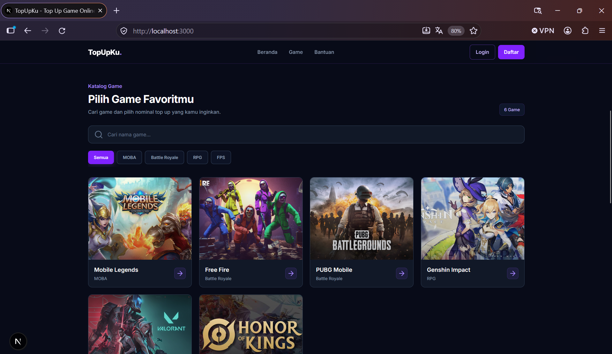
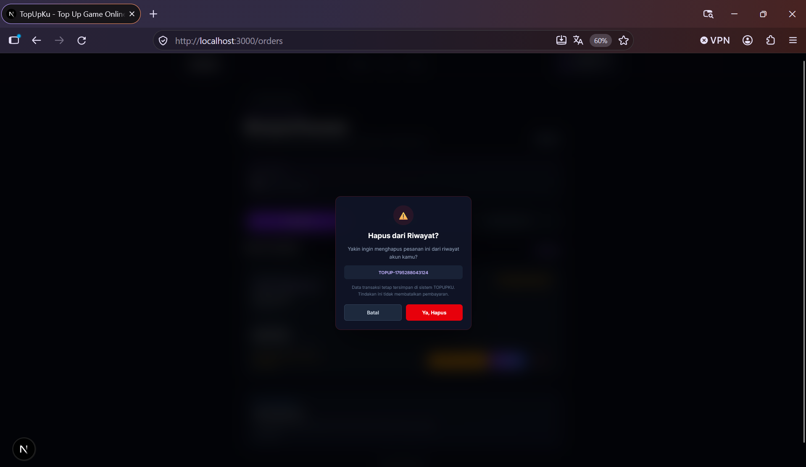
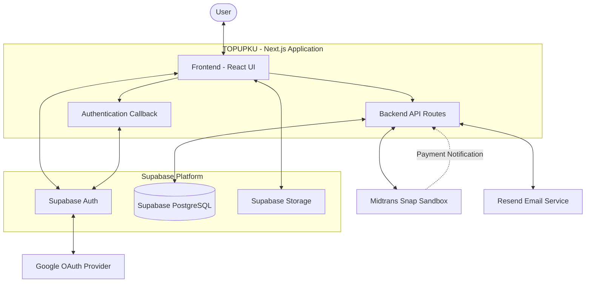
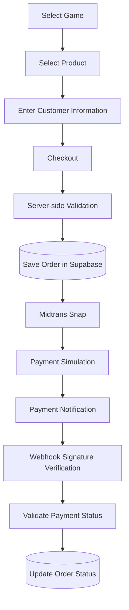
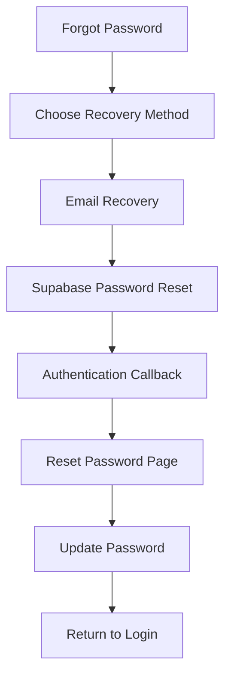
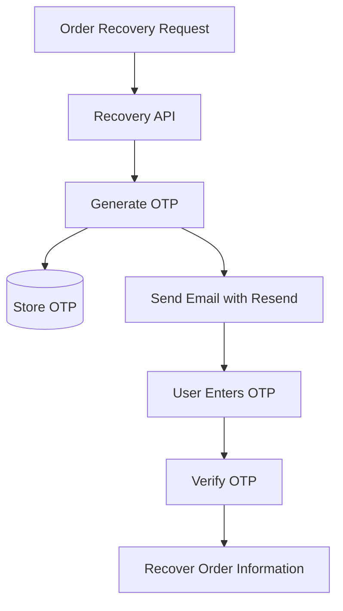

# TOPUPKU

<p align="left">
  
  
  
  
  
  
  
</p>

**A Game Top-Up Web Application — Full-Stack Development & Business Concept Project**

TOPUPKU is a personal full-stack web development project that simulates an online game top-up platform. It explores modern web technologies, user experience design, authentication, transaction management, database integration, and payment gateway integration.

---

---

## Project Status

**Development Status: Temporarily Paused (Development Hiatus)**

As of November 22, 2026, active development of TOPUPKU is temporarily paused.

The project has reached its current development milestone. Further development is being deferred because continuing the project requires time, resources, and a level of focus that are not currently available.

The developer is prioritizing securing stable and sustainable employment in Jakarta, with a preference for long-term opportunities and employment contracts that offer clear continuation prospects rather than uncertain short-term engagements.

TOPUPKU remains a personal software development and business concept initiative. Development may resume when professional circumstances, time, and available resources allow.

The existing source code and documentation are preserved in this repository.

**Current priority: Career stability and sustainable employment.**

### Important Notice

TOPUPKU is not currently operating as a commercial service.

- Production payment processing is not enabled.
- Midtrans is configured for Sandbox development.
- Automated game credit delivery is not implemented.
- External payment and email integrations have not completed full production verification.

---

## Table of Contents

- [Overview](#overview)
- [Business Concept](#business-concept)
- [Features](#features)
- [User Interface and Experience](#user-interface-and-experience)
- [System Architecture](#system-architecture)
- [System Workflows](#system-workflows)
- [Technology Stack](#technology-stack)
- [API Endpoints](#api-endpoints)
- [Database](#database)
- [Project Structure](#project-structure)
- [Getting Started](#getting-started)
- [Verification and Testing](#verification-and-testing)
- [Limitations](#limitations)
- [Roadmap](#roadmap)
- [Development Hiatus](#development-hiatus)
- [Author](#author)
- [Disclaimer](#disclaimer)

---

## Overview

TOPUPKU simulates the purchasing experience of an online game top-up platform.

The application demonstrates how a digital commerce platform can connect frontend interfaces, backend processing, authentication, database operations, and third-party services.

The project focuses on:

- Full-stack web application development.
- User authentication and session management.
- Game catalog and product selection.
- Checkout and order processing.
- Transaction and payment integration.
- User profile management.
- Order history and recovery.
- Responsive user interface development.

---

## Business Concept

TOPUPKU is designed around a digital game top-up business concept.

The proposed platform provides a centralized interface where users can browse game products, select denominations, enter their game account information, and proceed through a simulated purchasing process.

### Proposed Business Flow

1. Users access the TOPUPKU platform.
2. Users browse available game categories.
3. Users select a game and top-up product.
4. Users enter the required game account information.
5. Users proceed to checkout.
6. The system validates the order and product price.
7. The order is recorded in the database.
8. Users proceed to the available payment simulation.
9. The transaction status can be processed through payment notification integration.

### Business Scope

The project currently focuses on building the technical foundation of a digital top-up platform.

Commercial operations, supplier partnerships, automated fulfillment, and production payment processing remain outside the current implementation scope.

---

## Features


### Implemented

- [x] Homepage and game catalog.
- [x] Game and product selection.
- [x] Product detail and checkout interface.
- [x] Customer and game account information form.
- [x] User registration and email-password login.
- [x] Supabase authentication and session handling.
- [x] Google OAuth integration configuration and login implementation.
- [x] Authentication callback and session exchange.
- [x] User profile and profile editing.
- [x] Order creation and order history.
- [x] Server-side product and price validation.
- [x] Order recovery using email OTP.
- [x] Midtrans Snap Sandbox integration.
- [x] Payment notification API endpoint.
- [x] Webhook signature verification implementation.
- [x] Payment status validation.
- [x] Soft-delete functionality for order history.
- [x] Login-required checkout protection.
- [x] Forgot password interface.
- [x] Password reset page and password confirmation form.
- [x] Loading indicators for selected application processes.
- [x] Confirmation modal for order history actions.
- [x] Responsive and consistent navigation components.

### Implemented but Pending Verification

- [ ] Google OAuth end-to-end login verification.
- [ ] Complete password recovery through Supabase email.
- [ ] Successful password update using a recovery session.
- [ ] End-to-end payment notification delivery.
- [ ] Public HTTPS webhook integration testing.
- [ ] Complete end-to-end payment flow verification.

### Not Yet Available

- [ ] WhatsApp password recovery.
- [ ] Apple ID authentication.
- [ ] Automated game credit delivery.
- [ ] Production payment processing.
- [ ] Production deployment and monitoring.
- [ ] Automated application testing.

---

## User Interface and Experience

TOPUPKU uses a dark-themed interface with navy backgrounds and violet/blue accents.

The interface aims to provide a straightforward purchasing experience with clear navigation, accessible account features, and visual feedback during important user actions.

### Homepage

| Before Login | After Login |
|---|---|
|  |  |

### Game Catalog and Product Selection




### Checkout


### Authentication

| Login | Registration |
|---|---|
|  |  |


### Password Recovery

| Forgot Password | Password Reset |
|---|---|
|  |  |

Email-based password recovery uses Supabase Auth. Its complete end-to-end flow remains pending verification.

### Order History




### Additional Interface

| How To | Footer |
|---|---|
|  |  |

---


## System Architecture

TOPUPKU is built using a full-stack architecture based on Next.js, Supabase, and external service integrations.

The application uses Next.js for frontend rendering and backend API processing. Supabase provides authentication, session management, and PostgreSQL database services.

Google OAuth is integrated through Supabase Auth to support Google account authentication. Midtrans provides payment processing through its Sandbox environment, while Resend handles email delivery for order recovery OTP.



### Main Components

**Frontend**
- Homepage and game catalog.
- Authentication pages.
- Email and password login.
- Google OAuth login.
- Checkout interface.
- User profile and profile editing.
- Order history.
- Password recovery interface.

**Backend**
- Order processing.
- Product and price validation.
- Order history management.
- Payment notification handling.
- Order recovery OTP processing.
- Authentication callback handling.

**Supabase**
- PostgreSQL database.
- User authentication.
- OAuth provider integration.
- Session management.
- Application data storage.
- Storage services for supported file uploads.

**Google OAuth**
- Google account authentication.
- OAuth authorization and consent.
- Secure authentication flow through Supabase Auth.
- Redirect handling through the TOPUPKU authentication callback.

**Midtrans**
- Snap payment integration.
- Sandbox payment simulation.
- Payment notification integration.

**Resend**
- Email delivery for the existing order recovery OTP functionality.


---

## System Workflows

### 1. Order and Payment Flow



The backend validates order information and payment notifications before updating transaction status.

The integration has been implemented at the code level, but complete external notification delivery has not been verified.

### 2. Authentication Flow


Supabase Auth manages user authentication and session handling.

### 3. Password Recovery Flow



Email recovery has been implemented in the application interface. However, the complete recovery process remains pending successful verification.

WhatsApp recovery is not available.

### 4. Order Recovery Flow



This is a separate functionality from account password recovery.

---

## Technology Stack

| Category | Technology |
|---|---|
| Framework | Next.js 16 |
| UI Library | React 19 |
| Programming Language | TypeScript |
| Styling | Tailwind CSS v4 |
| Database | Supabase PostgreSQL |
| Authentication | Supabase Auth |
| Payment Gateway | Midtrans Snap |
| Email Service | Resend |
| Package Manager | npm |
| Version Control | Git |
| Repository Hosting | GitHub |
| Development Environment | Visual Studio Code |

---

## API Endpoints

| Method | Endpoint | Description |
|---|---|---|
| POST | `/api/orders` | Create an order |
| GET | `/api/orders` | Retrieve order history |
| DELETE | `/api/orders` | Hide an order from user history |
| POST | `/api/orders/recovery/request` | Request order recovery OTP |
| POST | `/api/orders/recovery/verify` | Verify order recovery OTP |
| POST | `/api/midtrans/notification` | Receive payment notifications |

Order deletion uses a soft-delete approach. It hides the order from the user's history and does not automatically cancel an external payment or remove the underlying transaction record.

---

## Database

TOPUPKU uses Supabase PostgreSQL for application data storage.

Known application tables include:

| Table | Purpose |
|---|---|
| `orders` | Stores order and transaction information |
| `order_recovery_otps` | Stores order recovery OTP information |

User authentication is managed separately through Supabase Auth.

---

## Project Structure

```text
topupku/
├── app/
│   ├── api/
│   │   ├── midtrans/
│   │   │   └── notification/
│   │   └── orders/
│   │       └── recovery/
│   ├── auth/
│   │   └── callback/
│   ├── checkout/
│   ├── login/
│   ├── orders/
│   ├── profile/
│   │   └── edit/
│   ├── register/
│   └── reset-password/
├── components/
├── docs/
│   └── screenshots/
├── lib/
│   └── supabase/
├── proxy.ts
├── package.json
└── README.md
```

---

## Getting Started

### Requirements

- Node.js
- npm
- Supabase project
- Midtrans Sandbox account
- Resend account (for existing order recovery email functionality)

### Installation

```bash
git clone https://github.com/imammularif/topupku.git

cd topupku

npm install
```

### Environment Variables

Create a `.env.local` file in the project root.

```env
NEXT_PUBLIC_SUPABASE_URL=
NEXT_PUBLIC_SUPABASE_ANON_KEY=

SUPABASE_URL=
SUPABASE_SECRET_KEY=

MIDTRANS_SERVER_KEY=
MIDTRANS_SIGNATURE_SECRET_KEY=
NEXT_PUBLIC_MIDTRANS_CLIENT_KEY=
MIDTRANS_IS_PRODUCTION=false

RESEND_API_KEY=
RESEND_FROM_EMAIL=

ORDER_OTP_SECRET=
```

Use your own credentials from the respective service providers.

**Security Notes**

- Never commit `.env.local` to GitHub.
- Keep server-side secrets private.
- Never expose Supabase secret keys or Midtrans Server Key in client-side code.
- Use Sandbox credentials during development.
- Do not share API keys, access tokens, or other credentials publicly.

### Run Locally

```bash
npm run dev
```

Open:

```text
http://localhost:3000
```

### Type Checking

```bash
npm run typecheck
```

---

## Verification and Testing

Latest recorded verification checkpoint: November 22, 2026.

| Check | Status |
|---|---|
| TypeScript type checking | Passed |
| Git working tree after push | Clean |
| GitHub synchronization | Passed |
| Git push | Passed |
| Password recovery email delivery | Rate limited during testing |
| Password update through recovery session | Pending verification |
| Midtrans end-to-end payment | Not verified |
| Public webhook integration | Not verified |
| Production deployment | Not performed |

A successful TypeScript check confirms that the application passes the configured type checking process. It does not guarantee that all external services or production integrations work correctly.

---

## Limitations

- The application is not operating commercially.
- Midtrans is used in Sandbox mode.
- Automated game credit fulfillment is not implemented.
- Public webhook integration testing remains pending.
- Password recovery has not completed end-to-end verification.
- WhatsApp, Google, and Apple authentication are unavailable.
- Automated testing and production monitoring are not yet implemented.
- Additional security and deployment work is required before any production launch.

---

## Roadmap

The following items represent potential future development work. They are not commitments to an active development schedule.

- [x] Core application and game catalog.
- [x] Authentication and profile management.
- [x] Order creation and order history.
- [x] Order recovery OTP functionality.
- [x] Midtrans Snap Sandbox integration.
- [x] Payment notification endpoint.
- [x] Login-required checkout protection.
- [x] Order history soft deletion.
- [x] Forgot password interface.
- [x] Password reset page.
- [ ] Complete password recovery verification.
- [ ] Complete payment end-to-end testing.
- [ ] Automated testing and security review.
- [ ] Production deployment.
- [ ] Automated game top-up fulfillment.
- [ ] Additional authentication providers.
- [ ] WhatsApp recovery integration.

---

## Development Hiatus

TOPUPKU is currently in a temporary development hiatus.

This decision reflects the project's current development limitations and the need to prioritize professional stability.

The developer is focusing on securing employment in Jakarta, prioritizing sustainable career opportunities, clear employment continuation prospects, and long-term stability over uncertain short-term contracts.

Further TOPUPKU development will be considered when sufficient time, resources, and professional circumstances allow.

The current source code, implementation progress, and documentation remain preserved in this GitHub repository.

**Project status: Temporarily Paused.**

**Development checkpoint: November 22, 2026.**

---

## Author

**Imammul Arif**

- GitHub: [github.com/imammularif](https://github.com/imammularif)
- Portfolio: [imammularif.github.io/portfolio-V2.0](https://imammularif.github.io/portfolio-V2.0)

---

## Disclaimer

TOPUPKU is an independent personal learning, software development, and business concept project.

It is not affiliated with, sponsored by, or officially endorsed by any game publisher, payment provider, or third-party service mentioned in this repository.

All trademarks, product names, and brand names belong to their respective owners.
