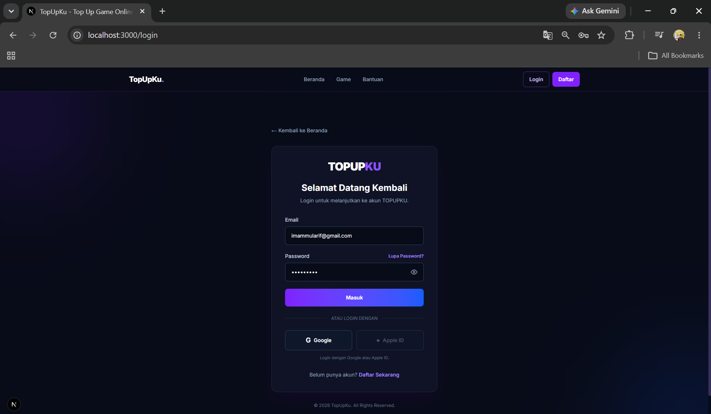

# TopUpKu — Game Top-Up Website


TopUpKu is a full-stack game top-up website prototype built with Next.js and TypeScript. It provides a simple interface for browsing game products, creating orders, initiating payments, and recovering order information.

**Development has been temporarily paused since November 2026** while I prioritize my professional career. This project remains an independent learning and portfolio project.

> TopUpKu is not currently operating as a commercial game top-up service.

## Features

- **Game Catalog** — Browse available games and product options.
- **Order Management** — Create orders and store order information.
- **Checkout** — Collect customer details and initiate payment transactions.
- **Payment Integration** — Midtrans Snap Sandbox checkout.
- **Order Tracking** — Search orders by order number or game account details.
- **Order Recovery** — Recover order numbers through email-based OTP verification.
- **Search History** — Review and manage previous searches locally.
- **Responsive Interface** — Dark-themed interface with purple and blue accents.

## Screenshots

The following screenshots show selected parts of the application.

| Game Catalog | Order History |
|---|---|
|  |  |

| Login Page | Payment Simulation |
|---|---|
|  |  |

## Technology Stack

| Technology | Purpose |
|---|---|
| Next.js 16 | Full-stack React framework |
| React | User interface |
| TypeScript | Type safety |
| Tailwind CSS | Styling |
| Supabase | Database integration |
| PostgreSQL | Relational database |
| Resend | Email delivery for OTP |
| Midtrans Snap | Payment gateway integration |
| Git & GitHub | Version control |

## Application Architecture

TopUpKu uses Next.js for both frontend and backend functionality.

```text
User
 │
 ▼
Next.js Application
 │
 ├── Game Catalog
 ├── Checkout
 ├── Order Tracking
 └── Order Recovery
      │
      ▼
 Next.js API Routes
      │
      ├── Supabase PostgreSQL
      ├── Resend Email Service
      └── Midtrans Snap
```

## Current Development Status

| Component | Status |
|---|---|
| Game Catalog | Implemented |
| Checkout Interface | Implemented |
| Order Creation API | Implemented |
| Supabase Integration | Implemented |
| Order History & Lookup | Implemented |
| Email OTP Recovery | Implemented |
| Resend Integration | Implemented |
| Midtrans Snap Sandbox | Implemented |
| Login & Authentication | Prototype UI |
| Payment Webhook | Not Implemented |
| Payment Status Synchronization | Not Implemented |
| Automated Game Top-Up | Not Implemented |

## Current Game Catalog

The prototype currently includes:

- Mobile Legends
- Free Fire
- PUBG Mobile
- Genshin Impact
- Valorant
- Honor of Kings

The available product catalog is still part of the prototype and does not represent a complete production-ready catalog for every game.

## Getting Started

### Prerequisites

- Node.js
- npm
- Git
- Supabase project
- Resend account
- Midtrans account for Sandbox testing

### Installation

Clone the repository:

```bash
git clone https://github.com/imammularif/topupku.git
```

Navigate to the project directory:

```bash
cd topupku
```

Install dependencies:

```bash
npm install
```

### Environment Configuration

Create an `.env.local` file in the project root:

```env
SUPABASE_URL=your_supabase_project_url
SUPABASE_SECRET_KEY=your_supabase_secret_key

RESEND_API_KEY=your_resend_api_key
RESEND_FROM_EMAIL=your_verified_sender_email

ORDER_OTP_SECRET=your_random_secret

MIDTRANS_SERVER_KEY=your_midtrans_server_key
NEXT_PUBLIC_MIDTRANS_CLIENT_KEY=your_midtrans_client_key
MIDTRANS_IS_PRODUCTION=false
```

Replace the placeholder values with your own credentials.

**Security notes:**
- Never expose Supabase secret keys, Resend API keys, or Midtrans Server Keys in client-side code.
- Keep `.env.local` out of version control.
- Use Midtrans Sandbox credentials for testing.

### Database Setup

TopUpKu uses Supabase PostgreSQL.

The application uses the following database tables:

- `orders` — Stores customer and order information.
- `order_recovery_otps` — Stores OTP recovery records.

Database schema and permissions must be configured in Supabase before running the application.

### Run Locally

Start the development server:

```bash
npm run dev
```

Open [http://localhost:3000](http://localhost:3000) in your browser.

Build the application:

```bash
npm run build
```

## Known Limitations

TopUpKu is a prototype and is not production-ready.

- Payment integration currently uses Midtrans Sandbox.
- Payment notification webhooks are not implemented.
- Automatic payment status synchronization is not available.
- Game top-up fulfillment is not connected to a supplier API.
- Login and authentication are not implemented.
- WhatsApp-based order recovery is not available.
- Search history is stored locally in the browser.
- Additional API security and privacy protections are required before production deployment.

## Future Improvements

Potential development plans include:

- Implement Midtrans payment notification webhooks.
- Synchronize payment status with Supabase.
- Improve API security and order validation.
- Implement user authentication.
- Integrate external game top-up providers.
- Automate order fulfillment.
- Expand the game and digital product catalog.
- Improve monitoring and error handling.

## Disclaimer

TopUpKu is an independent learning and portfolio project.

- It is not affiliated with or officially endorsed by the game publishers mentioned in this repository.
- All product names and trademarks belong to their respective owners.
- The current payment integration is intended for Sandbox testing only.
- No real game top-up fulfillment is currently provided.

## Author

**Imammul Arif**

- GitHub: [@imammularif](https://github.com/imammularif)
- Repository: [TopUpKu](https://github.com/imammularif/topupku)
- Portfolio: [imammularif.github.io/portfolio-V2.0](https://imammularif.github.io/portfolio-V2.0)
