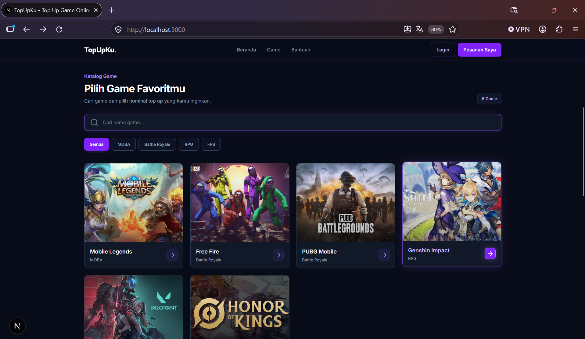
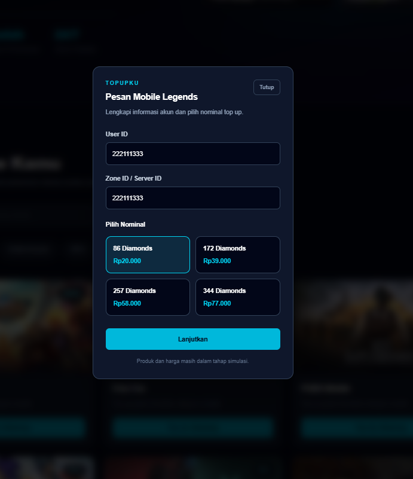
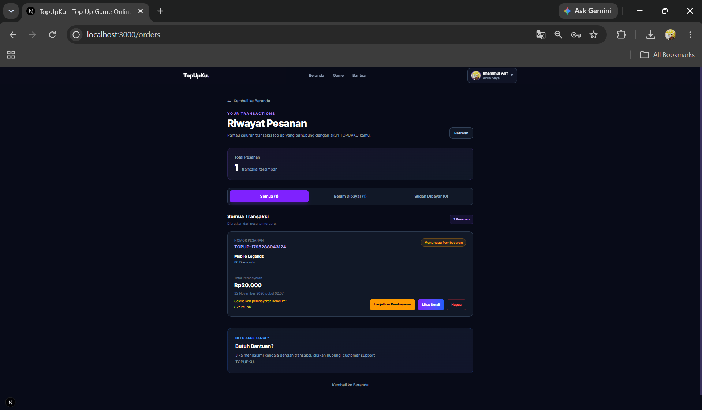
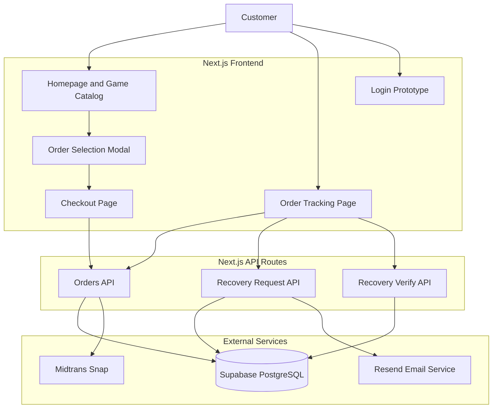
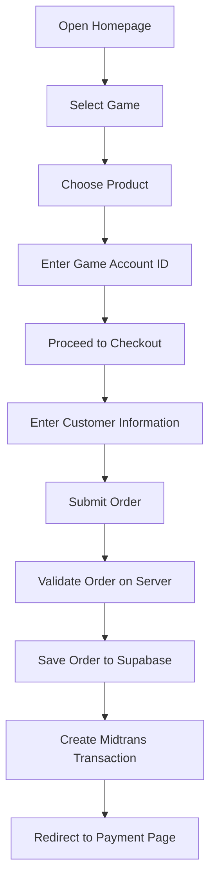
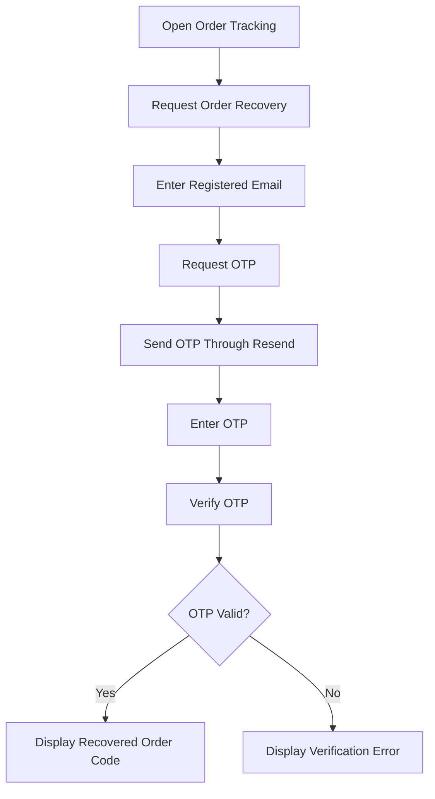

# TopUpKu — Game Top-Up Website

A web-based game top-up platform built with **Next.js, TypeScript, Tailwind CSS, Supabase, and Midtrans Snap**.

> **Project Status: Temporarily On Hold**
>
> Development is temporarily paused as of November 2026 while I prioritize my professional career and job search. This project remains part of my personal learning journey and technical portfolio. It is not currently operating as a commercial top-up service.

---

## 1. Project Overview

**TopUpKu** is a personal web development project designed to explore the development of a game top-up platform.

The application provides a game catalog, product selection, customer information forms, checkout flow, payment integration, order tracking, and order recovery through email verification.

The project focuses on implementing a structured full-stack application, integrating third-party services, and understanding real-world transaction workflows.

## 2. Features

### Customer Interface
- Game catalog with category filtering.
- Game search functionality.
- Product selection and order modal.
- Customer information form.
- Checkout and payment summary.
- Order tracking and search history.
- Order recovery through email OTP.
- Responsive dark gaming interface.

### Backend & Integration
- Next.js API routes for order management.
- Server-side product and price validation.
- Supabase database integration.
- Midtrans Snap payment integration.
- Email delivery integration using Resend.
- OTP-based order recovery workflow.

## 3. Application Screenshots

### Homepage


### Game Catalog



### Order Selection



### Checkout


### Payment Simulation


### Order History



### Login Interface


*Note: Login is currently a frontend prototype. Authentication has not been implemented.*

### How It Works


### Footer


## 4. System Architecture

The application uses the Next.js App Router architecture. The frontend communicates with internal API routes, which handle order processing and recovery operations.



### Architecture Components

| Component | Responsibility |
|---|---|
| Next.js Frontend | User interface and customer interactions |
| Next.js API Routes | Order processing and recovery endpoints |
| Supabase | Database storage |
| PostgreSQL | Relational data management |
| Midtrans Snap | Payment transaction integration |
| Resend | Email delivery for order recovery |

## 5. Core Workflows

### Order Creation and Payment



### Order Recovery



## 6. API Structure

| Method | Endpoint | Description |
|---|---|---|
| POST | `/api/orders` | Create a new order |
| GET | `/api/orders` | Retrieve and search orders |
| POST | `/api/orders/recovery/request` | Request order recovery OTP |
| POST | `/api/orders/recovery/verify` | Verify OTP and recover order information |

## 7. Project Structure

```text
topupku/
├── app/
│   ├── api/
│   │   └── orders/
│   │       ├── route.ts
│   │       └── recovery/
│   │           ├── request/
│   │           │   └── route.ts
│   │           └── verify/
│   │               └── route.ts
│   ├── checkout/
│   │   └── page.tsx
│   ├── login/
│   │   └── page.tsx
│   ├── orders/
│   │   └── page.tsx
│   ├── globals.css
│   ├── layout.tsx
│   └── page.tsx
├── components/
│   ├── GameCard.tsx
│   ├── GameSection.tsx
│   ├── HeroSection.tsx
│   ├── Navbar.tsx
│   └── OrderModal.tsx
├── data/
│   └── games.ts
├── docs/
│   └── screenshots/
├── lib/
│   └── supabaseAdmin.ts
├── public/
│   └── games/
├── .env.local
├── package.json
└── README.md
```

## 8. Technology Stack

| Technology | Purpose |
|---|---|
| Next.js | Full-stack React framework |
| React | User interface |
| TypeScript | Type-safe development |
| Tailwind CSS | Styling and responsive design |
| Supabase | Backend database service |
| PostgreSQL | Relational database |
| Midtrans Snap | Payment integration |
| Resend | Email delivery |
| Git & GitHub | Version control |

## 9. Supported Games

The current game catalog contains:

- Mobile Legends
- Free Fire
- PUBG Mobile
- Genshin Impact
- Valorant
- Honor of Kings

*Product availability and denomination support are still limited and subject to further development.*

## 10. Getting Started

### Prerequisites

- Node.js
- npm
- Supabase project
- Midtrans account for payment testing
- Resend account for email functionality

### Installation

Clone the repository:

```bash
git clone https://github.com/imammularif/topupku.git
```

Navigate to the project directory:

```bash
cd topupku
```

Install dependencies:

```bash
npm install
```

Create a `.env.local` file in the project root and configure the required environment variables.

Run the development server:

```bash
npm run dev
```

Open [http://localhost:3000](http://localhost:3000) in your browser.

## 11. Environment Variables

Configure the following variables in `.env.local`:

```env
SUPABASE_URL=
SUPABASE_SECRET_KEY=

RESEND_API_KEY=
RESEND_FROM_EMAIL=

ORDER_OTP_SECRET=

MIDTRANS_SERVER_KEY=
NEXT_PUBLIC_MIDTRANS_CLIENT_KEY=
MIDTRANS_IS_PRODUCTION=false
```

**Important:** Never expose secret keys or commit `.env.local` to a public repository.

Use sandbox credentials when testing Midtrans integration.

## 12. Database Overview

The application uses Supabase with PostgreSQL as its database.

The current implementation includes data storage for:

- **orders** — customer orders, game account information, product details, prices, payment information, and order status.
- **order_recovery_otps** — OTP records used in the order recovery process.

Database schema, access policies, and transaction handling may evolve as development continues.

## 13. Current Limitations

The project is still a work in progress.

Known limitations include:

- Login and authentication are not implemented.
- Game product catalogs are not yet fully customized for every supported game.
- Automated order fulfillment is not implemented.
- Payment webhook status synchronization remains incomplete.
- Customer support functionality is not yet operational.
- Additional security and privacy hardening is required before public deployment.

## 14. Future Development

Potential improvements when development resumes:

- Implement customer authentication.
- Expand and maintain game-specific product catalogs.
- Complete Midtrans webhook integration.
- Implement automated payment status synchronization.
- Develop order fulfillment workflows.
- Improve API security and data privacy.
- Implement customer support functionality.
- Improve testing, monitoring, and deployment readiness.

## 15. Disclaimer

TopUpKu is an independent personal development project created for educational and portfolio purposes.

It is not affiliated with, endorsed by, or officially connected to the game publishers or payment service providers mentioned in this repository.

All game names and trademarks belong to their respective owners.

## 16. Author

**Imammul Arif**

- GitHub: [@imammularif](https://github.com/imammularif)
- Portfolio: [Personal Portfolio](https://imammularif.github.io/portfolio-V2.0/)

---

*Built as a personal learning project with Next.js and TypeScript.*
