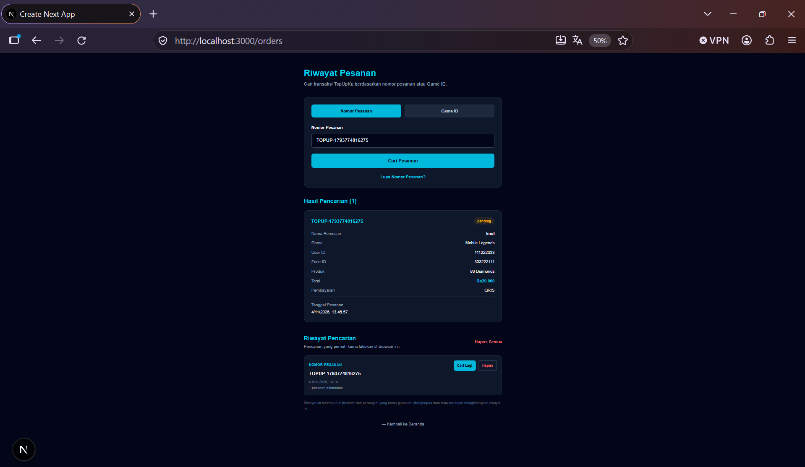
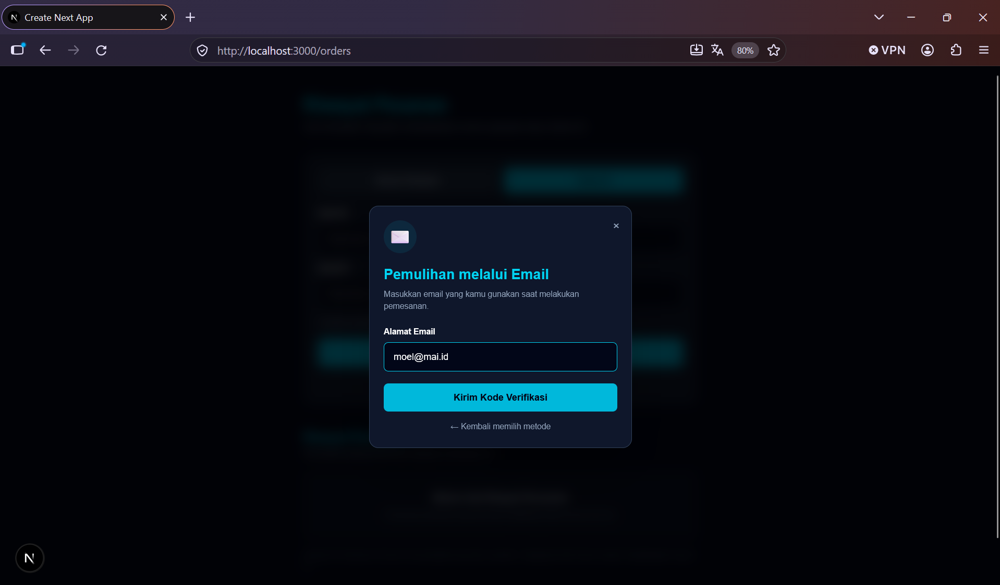
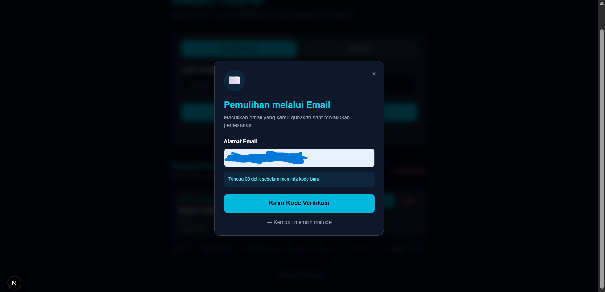
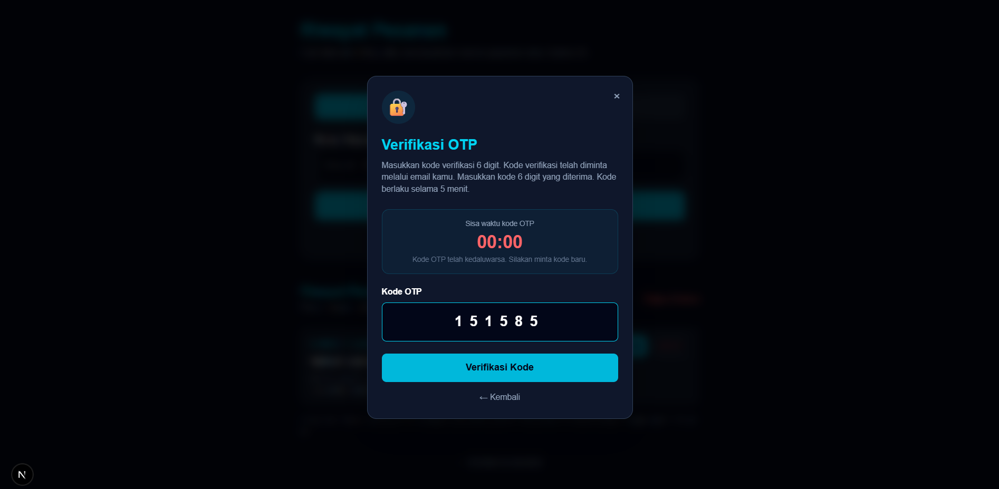
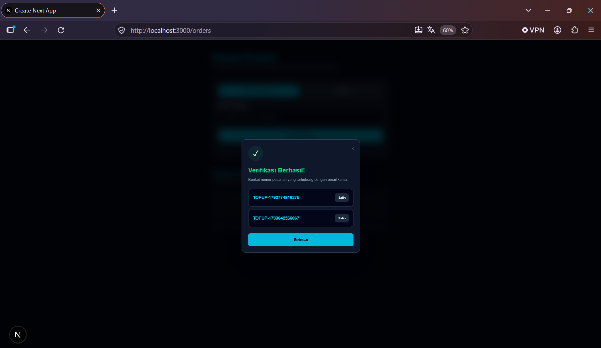

# TopUpKu — Game Top-Up Website


**Development Status**

TopUpKu is temporarily on hold as of November 2026.

Development activities are temporarily paused as I prioritize my career and focus on securing a stable, long-term employment opportunity with potential for contract extension and career growth, rather than short-term employment.

TopUpKu is an independent personal project developed gradually by its author, step by step, alongside other personal and professional commitments. Future development will continue incrementally as time and resources become available.

The current repository preserves the latest development progress, including the Next.js application, Supabase integration, order management, OTP-based order recovery, and Midtrans Snap Sandbox checkout integration.

TopUpKu remains an independent website prototype and is not currently operating as a commercial game top-up service.

**Thank You**

Thank you for taking the time to visit and explore TopUpKu. I sincerely appreciate your interest, support, and understanding during this temporary development pause.

Although development is currently on hold, I hope to continue improving TopUpKu little by little, one step at a time, when circumstances allow. Thank you for being part of this journey.

A game top-up website prototype built with **Next.js, TypeScript, Supabase, Resend, and Midtrans**.

TopUpKu was developed to provide a simple and user-friendly platform for browsing game products, placing top-up orders, initiating test payments, and tracking order history.

**Latest Development Status:** The prototype includes order management, Supabase database integration, email-based order recovery, and Midtrans Snap Sandbox checkout integration. Full payment confirmation and webhook integration remain under development.

---

## Screenshots

### Homepage


### Game Selection


### Checkout Page


### Order History


### Search History




Users can review previous searches, repeat a search, and manage their local search history.

### Order Details


### Forgot Order Number


An order number recovery feature that allows users to recover previous order numbers using email verification.

### Email Recovery






Users can request an order recovery verification code using their registered email address.

The backend checks whether the email is associated with existing order records before processing the recovery request.

### OTP Verification




An email-based OTP verification process integrated with Resend.

- Six-digit verification code.
- OTP expiration after five minutes.
- Email-based verification through backend API routes.
- OTP values are hashed before being stored in Supabase.
- Verification attempts are limited to prevent repeated guessing.

### Recovery Result



After successful OTP verification, the system retrieves and displays order numbers associated with the verified email address.

Users can copy their recovered order numbers directly from the result interface.

### Payment Gateway — Midtrans Sandbox

TopUpKu integrates **Midtrans Snap** in Sandbox mode to provide a hosted payment checkout experience.


The payment flow allows customers to continue from the TopUpKu checkout page to the Midtrans hosted payment page.

Supported payment options displayed by Midtrans depend on the merchant account configuration.

Current integration includes:

- Midtrans Snap transaction creation through a backend API.
- Automatic redirect to the Midtrans payment page.
- Sandbox environment configuration.
- Payment method selection on the Midtrans hosted checkout.
- QRIS and other payment options when available in the Sandbox account.

**Note:** The checkout redirect and payment options have been tested. Full end-to-end payment confirmation, webhook processing, and automatic order status synchronization are still under development. Sandbox testing does not represent real customer payments.

---

## Features

### Game Catalog & Checkout

- Browse available games and their product catalogs.
- Enter game account details (User ID and Zone ID).
- Select game products and proceed through checkout.
- Enter customer information.
- Create orders through a backend API.
- Continue to Midtrans hosted payment checkout.

### Payment Integration

- Midtrans Snap Sandbox integration.
- Server-side transaction creation.
- Automatic redirect to the Midtrans payment page.
- Payment method selection through Midtrans.
- QRIS, E-Wallet, Virtual Account, and bank transfer options when enabled and available.

### Order Management

- Create and manage top-up orders.
- Store order information in Supabase.
- View order history.
- Look up orders using order numbers or game account details.
- Manage search history.

### Order Recovery

- Access the forgot order number feature.
- Recover order numbers through email-based OTP verification.
- Verify OTP codes with expiration handling.
- Display and copy recovered order numbers.

---

## Planned Product Expansion

TopUpKu is designed to support various digital products, including:

- **Game Currency:** Diamonds, UC, Genesis Crystals, Valorant Points, and other in-game currencies.
- **Game Membership:** Weekly Pass, Monthly Card, and other game subscriptions.
- **Game Vouchers:** Digital game vouchers and prepaid codes.
- **Digital Gift Cards:** Steam Wallet, Google Play, PlayStation Store, and other digital gift cards.
- **Gaming Subscriptions:** PlayStation Plus, Xbox Game Pass, and other gaming subscriptions.

---

## Tech Stack

| Technology | Purpose |
|---|---|
| Next.js 16 | React framework and API routes |
| React | User interface |
| TypeScript | Type-safe development |
| Tailwind CSS | Styling |
| Supabase | Backend and database integration |
| PostgreSQL | Relational data storage |
| Resend | Transactional email delivery |
| Midtrans Snap | Payment gateway integration |
| Git & GitHub | Version control |

---

## Supported Games

- Mobile Legends
- Free Fire
- PUBG Mobile
- Genshin Impact
- Valorant
- Honor of Kings

---

## Payment Methods

TopUpKu uses Midtrans Snap as its payment gateway in Sandbox mode.

Payment options available on the hosted checkout may include:

- QRIS
- E-Wallet
- Virtual Account
- Bank Transfer

Payment method availability depends on the Midtrans merchant configuration and enabled payment channels.

**Important:** The current integration is for Sandbox testing only. Production payment processing has not been enabled.

---

## Planned Integrations

### Payment Gateway — Midtrans

The Midtrans Snap integration is currently available in Sandbox mode.

Implemented:

- Midtrans Sandbox account setup.
- Server and Client Key configuration.
- Backend Snap transaction creation.
- Order creation before payment.
- Redirect to the Midtrans hosted checkout.
- Payment method selection through Midtrans.

Remaining development:

- Complete end-to-end Sandbox payment testing.
- Implement Midtrans payment notification webhook.
- Verify payment notification signatures.
- Synchronize payment status with Supabase.
- Store the actual payment method returned by Midtrans.
- Handle pending, successful, expired, and failed transactions.
- Perform additional transaction security testing.
- Prepare production integration.

### Game Top-Up Provider

TopUpKu is planned to integrate with external game top-up suppliers through API services.

Planned features:

- Supplier API integration.
- Product and price synchronization.
- Automated order fulfillment.
- Transaction status updates.
- Mock Supplier API for development and testing.

**Note:** Automated game top-up fulfillment is not yet connected to an external supplier.

---

## Getting Started

### Prerequisites

Make sure you have installed:

- Node.js
- npm
- Git

You also need:

- A Supabase project.
- A Resend account for email-based OTP delivery.
- A Midtrans account for payment gateway testing.

### 1. Clone the Repository

```bash
git clone https://github.com/imammularif/topupku.git
```

### 2. Navigate to the Project Directory

```bash
cd topupku
```

### 3. Install Dependencies

```bash
npm install
```

### 4. Configure Environment Variables

Create an `.env.local` file in the project root:

```env
SUPABASE_URL=your_supabase_project_url
SUPABASE_SECRET_KEY=your_supabase_secret_key

RESEND_API_KEY=your_resend_api_key
RESEND_FROM_EMAIL=TopUpKu <your-verified-sender-email>

ORDER_OTP_SECRET=your_random_32_byte_secret

MIDTRANS_SERVER_KEY=your_midtrans_server_key
NEXT_PUBLIC_MIDTRANS_CLIENT_KEY=your_midtrans_client_key
MIDTRANS_IS_PRODUCTION=false
```

Replace the placeholder values with your own credentials.

**Important:**

- `SUPABASE_SECRET_KEY` must only be used in server-side code.
- `RESEND_API_KEY` must never be exposed in client-side code.
- `ORDER_OTP_SECRET` should be a strong, randomly generated secret.
- `MIDTRANS_SERVER_KEY` must only be used in server-side code.
- `NEXT_PUBLIC_MIDTRANS_CLIENT_KEY` is intended for public client-side configuration.
- Set `MIDTRANS_IS_PRODUCTION=false` when using the Sandbox environment.
- Never commit `.env.local` or expose secret keys in your repository.

### 5. Configure the Database

TopUpKu uses Supabase PostgreSQL.

Create the required database tables:

- `orders` — Stores customer order information and transaction status.
- `order_recovery_otps` — Stores hashed OTP verification records and expiration information.

The `orders` table includes order information, customer details, product information, payment method, and order status.

The `payment_method` column must allow `NULL` while the payment method has not yet been confirmed. It can be updated after implementing verified Midtrans payment notifications.

Enable Row Level Security (RLS) and configure appropriate permissions for database access.

The recovery and order APIs use server-side Supabase credentials to access the required records.

### 6. Run the Development Server

```bash
npm run dev
```

Open http://localhost:3000 in your browser.

### 7. Run Type Checking

```bash
npm run typecheck
```

### 8. Production Build Verification

```bash
npm run build
```

---

## Database

TopUpKu uses Supabase with PostgreSQL to store order and recovery information.

### Orders Table

The `orders` table includes:

- Order ID.
- Order code.
- Customer name.
- Customer email.
- Customer phone.
- Game.
- User ID.
- Zone ID.
- Product.
- Price.
- Payment method.
- Order status.
- Creation timestamp.

Payment method information is currently allowed to remain empty until verified payment information is received.

### Order Recovery OTP Table

The `order_recovery_otps` table includes:

- Recovery record ID.
- Customer email.
- Hashed OTP.
- Expiration timestamp.
- Verification attempt counter.
- OTP consumption timestamp.
- Creation timestamp.

OTP records are used to support the email-based order recovery process.

---

## Project Structure

```text
topupku/
├── app/
│   ├── api/
│   │   └── orders/
│   │       ├── recovery/
│   │       │   ├── request/
│   │       │   │   └── route.ts
│   │       │   └── verify/
│   │       │       └── route.ts
│   │       └── route.ts
│   ├── checkout/
│   │   └── page.tsx
│   ├── orders/
│   │   └── page.tsx
│   ├── globals.css
│   ├── layout.tsx
│   └── page.tsx
├── components/
│   ├── GameCard.tsx
│   ├── GameSection.tsx
│   ├── HeroSection.tsx
│   ├── Navbar.tsx
│   └── OrderModal.tsx
├── data/
│   └── games.ts
├── lib/
│   └── supabaseAdmin.ts
├── public/
│   └── games/
├── docs/
│   └── screenshots/
├── package.json
├── package-lock.json
└── README.md
```

### Directory Overview

- **app/** – Next.js App Router pages, layouts, and API endpoints.
- **components/** – Reusable UI components.
- **data/** – Centralized game catalog and product data.
- **lib/** – Shared utilities and backend integration configurations.
- **public/** – Static assets, including game images.
- **docs/** – Project documentation and application screenshots.

---

## Current Limitations

TopUpKu is currently a functional prototype for learning and portfolio purposes.

- Midtrans integration is currently configured for Sandbox testing only.
- Full end-to-end payment confirmation has not yet been completed.
- Payment webhooks and automatic payment status synchronization are not yet implemented.
- Production payment processing is not available.
- Game top-up fulfillment is not connected to an external supplier.
- Email-based OTP recovery requires a verified Resend domain for customer-facing delivery.
- WhatsApp recovery is not yet available.
- Search history is stored locally in the browser and is not synchronized across devices.
- Public order lookup endpoints are intended for prototype testing only.

Additional authentication, authorization, API rate limiting, transaction verification, and privacy protections are required before production deployment.

---

## Roadmap

### Completed

**Core Application**

- [x] Homepage and game catalog.
- [x] Game selection interface.
- [x] Checkout page.
- [x] Order creation API.
- [x] Order history page.
- [x] Order lookup by order number or game account details.
- [x] Search history management.

**Backend & Integration**

- [x] Supabase database integration.
- [x] Email-based OTP recovery request API.
- [x] OTP verification API.
- [x] Secure OTP hashing and expiration handling.
- [x] Five-minute OTP expiration enforcement on the backend.
- [x] Resend email service integration.
- [x] Custom HTML email template for OTP recovery.
- [x] TOPUPKU email branding, subject, content, and visual design.
- [x] Email OTP delivery testing.
- [x] Recovered order number display and copy functionality.
- [x] OTP request cooldown handling.
- [x] Real-time five-minute OTP countdown timer.
- [x] Dynamic remaining OTP validity display.
- [x] OTP countdown warning when less than one minute remains.
- [x] OTP expiration message when countdown reaches zero.

**Payment Integration — Midtrans Sandbox**

- [x] Midtrans merchant account registration.
- [x] Sandbox credentials configuration.
- [x] Midtrans Snap transaction creation API.
- [x] Order creation integrated with payment checkout.
- [x] Redirect to Midtrans hosted payment page.
- [x] Payment method selection through Midtrans.
- [x] Initial Sandbox checkout testing.

**Code Structure & Development**

- [x] Modular homepage architecture.
- [x] Reusable UI components:
  - [x] Navbar.
  - [x] HeroSection.
  - [x] GameSection.
  - [x] GameCard.
  - [x] OrderModal.
- [x] Centralized game and product data management.
- [x] GitHub repository and version control.
- [x] Next.js 16.4.6 upgrade.
- [x] TypeScript type checking.
- [x] Production build verification.
- [x] GitHub synchronization and updates to the main branch.

### Future Development Plans

**Payment Integration**

- [ ] Complete QRIS Sandbox payment testing.
- [ ] Test Virtual Account and E-Wallet payment flows.
- [ ] Implement Midtrans payment notification webhook.
- [ ] Verify webhook signatures.
- [ ] Synchronize payment status with Supabase.
- [ ] Store verified payment method information.
- [ ] Handle successful, pending, expired, and failed payments.
- [ ] Prepare production integration.

**Email & OTP Enhancement**

- [ ] Add a clear OTP resend interface after the cooldown period.
- [ ] Improve email delivery monitoring and error handling.
- [ ] Verify a custom sending domain for Resend.
- [ ] Perform additional OTP expiration and resend testing.

**User Experience Improvements**

- [ ] Add copy order number notification.
- [ ] Improve checkout form validation.
- [ ] Add loading states for API requests.
- [ ] Prevent duplicate submissions during order processing.
- [ ] Improve responsive design for mobile devices.

**Code Quality & Security**

- [ ] Further code refactoring and service-layer separation.
- [ ] Implement reusable order history and recovery hooks.
- [ ] Improve order code generation.
- [ ] Strengthen API security and data protection.
- [ ] Implement IP-based rate limiting and abuse prevention.
- [ ] Implement customer authentication.
- [ ] Improve order lookup security and verification.

**Supplier Integration**

- [ ] Research suitable game top-up providers.
- [ ] Implement Mock Supplier API.
- [ ] Integrate supplier API.
- [ ] Implement automated order fulfillment.
- [ ] Implement transaction status synchronization.

**Product Catalog Expansion**

- [ ] Expand the catalog beyond game diamonds and currencies.
- [ ] Add game memberships and subscriptions.
- [ ] Add digital game vouchers and gift cards.
- [ ] Support more games and digital products.

**Integration & Deployment**

- [ ] Complete end-to-end payment testing.
- [ ] Complete end-to-end email recovery testing.
- [ ] Prepare production deployment.
- [ ] Complete security and transaction testing.

---

## Customer Support

TopUpKu provides an email contact channel for users who need assistance or have questions regarding their orders and transactions.

Email: your-support-email@example.com

When contacting support, users are encouraged to include:

- Order number (if available).
- Game name and product.
- Description of the issue or inquiry.
- Relevant transaction details.

**Note:** Never share passwords, OTP verification codes, or sensitive payment information through email.

---

## Disclaimer

TopUpKu is an independent learning and portfolio project.

The current payment integration uses the Midtrans Sandbox environment and is not intended for real customer transactions.

Game top-up fulfillment is not yet connected to an external supplier.

This project is not affiliated with or officially endorsed by the game publishers mentioned above.

---

## Author

**Imammul Arif**

GitHub: [@imammularif](https://github.com/imammularif)

Project Repository: [TopUpKu](https://github.com/imammularif/topupku)

Portfolio: [imammularif.github.io/portfolio-V2.0](https://imammularif.github.io/portfolio-V2.0)
