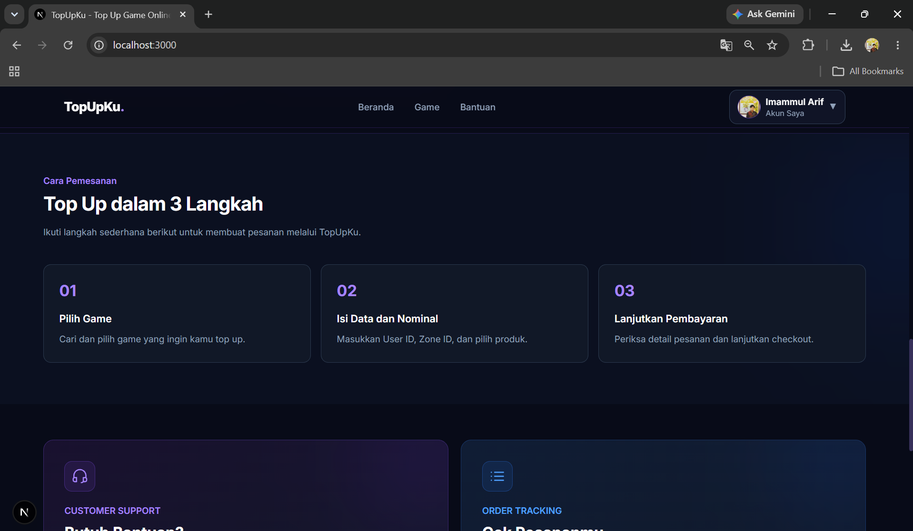
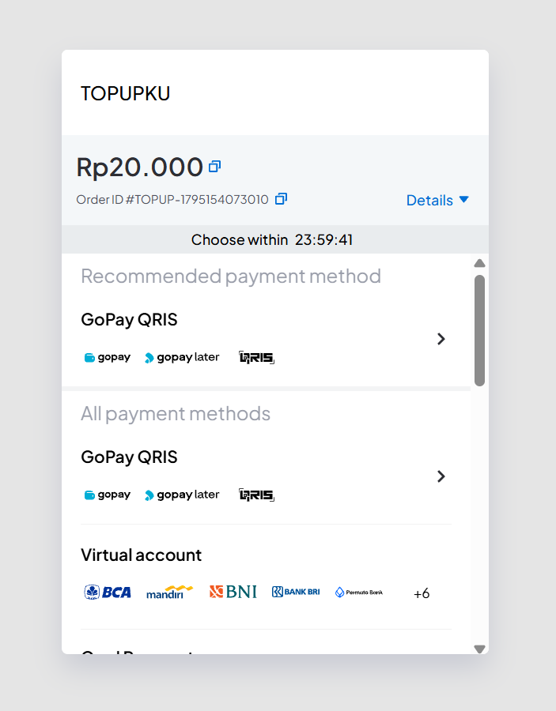
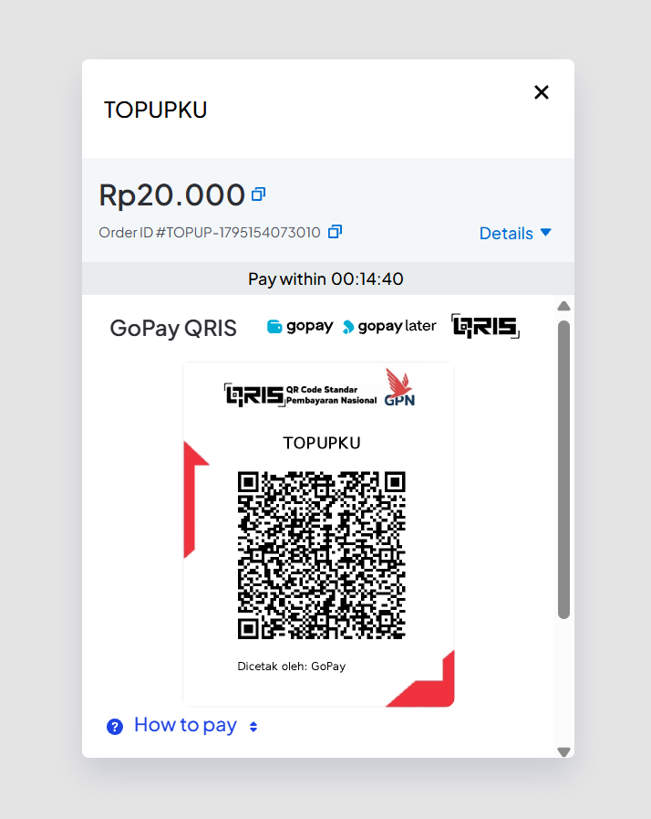
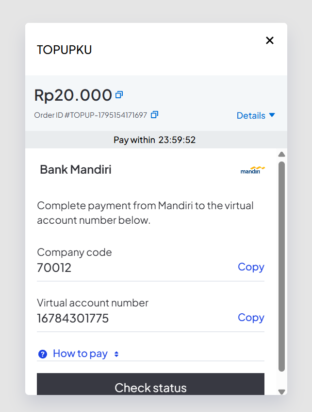
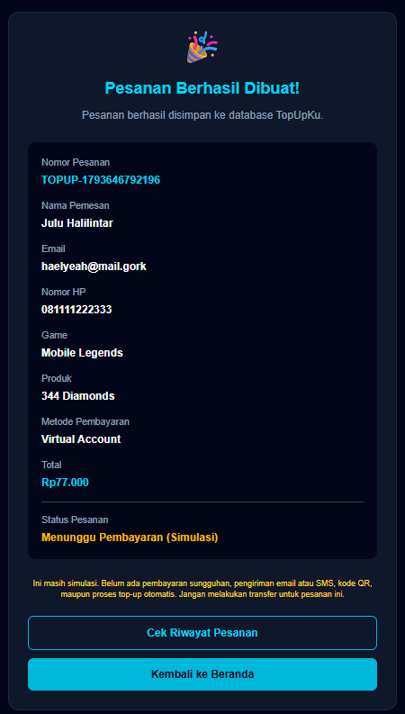
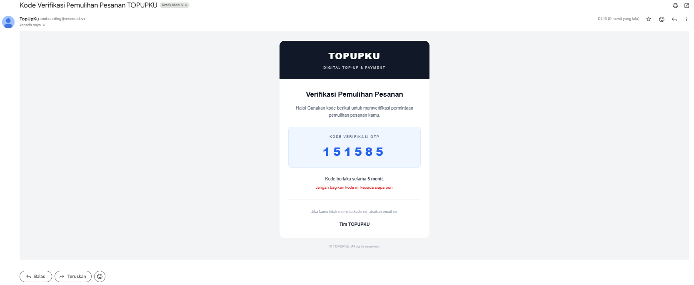
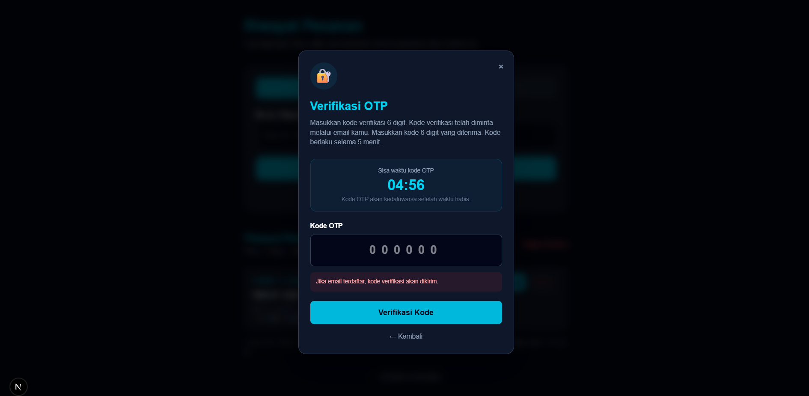
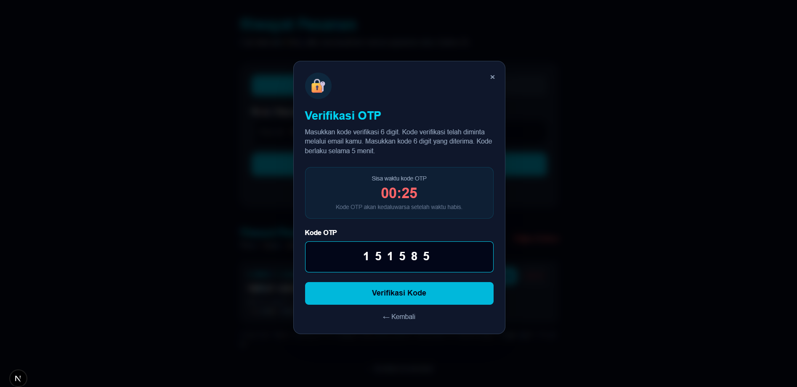

# TopUpKu — Game Top-Up Website


> **Development Notice**
>
> TopUpKu has been temporarily put on hold as of November 2026.
>
> Development is currently paused while I prioritize my career and job search, with the goal of securing stable, long-term employment and continuing my professional growth.
>
> TopUpKu is an independent personal project that I have developed gradually. Further development will resume when my time and resources allow.
>
> This repository preserves the latest development progress, including the Next.js application, Supabase database integration, order management, email-based OTP recovery, and Midtrans Snap Sandbox checkout integration.
>
> Please note that TopUpKu remains a personal website prototype for learning and portfolio purposes. It is not currently operating as a commercial game top-up service.
>
> **Thank You**
>
> Thank you for taking the time to explore TopUpKu. I sincerely appreciate your interest, support, and understanding during this temporary development pause.
>
> I look forward to continuing this project when circumstances allow.

---

## About the Project

TopUpKu is a game top-up website prototype built using **Next.js, TypeScript, Supabase, Resend, and Midtrans**.

The project aims to provide a simple and user-friendly platform where users can browse game products, create top-up orders, initiate payments, and track their order history.

### Current Development Status

The prototype currently includes:

- Game catalog and product selection.
- Checkout interface and order creation.
- Supabase PostgreSQL database integration.
- Order history and order lookup.
- Email-based order recovery with OTP verification.
- Resend integration for OTP email delivery.
- Midtrans Snap Sandbox checkout integration.

Payment notification webhooks, complete payment status synchronization, and automated game top-up fulfillment have not yet been implemented.

---

## Screenshots

The following screenshots illustrate the application's interface and development progress.

### 1. Homepage


### 2. Game Selection


### 3. How to Use



### 4. Checkout


### 5. Payment Gateway — Midtrans Sandbox

TopUpKu uses Midtrans Snap in Sandbox mode to provide a hosted payment checkout experience.







Current integration includes:

- Server-side Snap transaction creation.
- Redirect to the Midtrans hosted payment page.
- Sandbox environment configuration.
- Payment method selection through Midtrans.
- QRIS and other payment options when enabled in the merchant account.

**Note:** Checkout redirection and available payment options have been tested. Full end-to-end payment confirmation, webhook processing, and automatic order status synchronization are not yet implemented.

### 6. Order History



### 7. Order Details


### 8. Search History


Users can review previous searches, repeat a search, and manage their local search history.

### 9. Forgot Order Number


Users can recover previous order numbers through an email-based verification process.

### 10. Email Recovery


Users can request an order recovery verification code using their registered email address.

The backend checks whether the email address is associated with existing order records before processing the recovery request.

### 11. OTP Verification








The email-based OTP verification system is integrated with Resend.

Key features:

- Six-digit verification code.
- Five-minute OTP expiration.
- Backend-based email verification.
- Hashed OTP storage in Supabase.
- Verification attempt limits.
- OTP request cooldown and countdown handling.

### 12. Recovery Result


After successful OTP verification, the system retrieves and displays order numbers associated with the verified email address.

Users can copy their recovered order numbers directly from the result interface.

---

## Features

### Game Catalog & Checkout

- Browse available games and product catalogs.
- Select game products.
- Enter game account details, including User ID and Zone ID.
- Provide customer information.
- Create orders through a backend API.
- Continue to the Midtrans hosted payment page.

### Payment Integration

- Midtrans Snap Sandbox integration.
- Server-side transaction creation.
- Automatic redirect to hosted checkout.
- Payment method selection through Midtrans.
- Availability of QRIS, E-Wallet, Virtual Account, and bank transfer options, depending on merchant configuration.

### Order Management

- Create and store top-up orders.
- Save order information in Supabase.
- View order history.
- Look up orders using order numbers or game account details.
- Manage local search history.

### Order Recovery

- Forgot order number feature.
- Email-based OTP recovery.
- OTP expiration and verification handling.
- Display and copy recovered order numbers.

---

## Technology Stack

| Technology | Purpose |
|---|---|
| Next.js 16 | React framework and API routes |
| React | User interface |
| TypeScript | Type-safe development |
| Tailwind CSS | Styling |
| Supabase | Backend and database integration |
| PostgreSQL | Relational database |
| Resend | Transactional email delivery |
| Midtrans Snap | Payment gateway integration |
| Git & GitHub | Version control |

---

## Supported Games

The current game catalog includes:

- Mobile Legends
- Free Fire
- PUBG Mobile
- Genshin Impact
- Valorant
- Honor of Kings

---

## Planned Product Expansion

TopUpKu is designed with the potential to support additional digital products in the future.

| Product Category | Examples |
|---|---|
| Game Currency | Diamonds, UC, Genesis Crystals, Valorant Points |
| Game Membership | Weekly Pass, Monthly Card, game subscriptions |
| Game Vouchers | Digital game vouchers and prepaid codes |
| Digital Gift Cards | Steam Wallet, Google Play, PlayStation Store |
| Gaming Subscriptions | PlayStation Plus, Xbox Game Pass |

These categories are planned for future expansion and may require additional supplier integrations.

---

## Payment Methods

TopUpKu currently uses **Midtrans Snap in Sandbox mode**.

Available payment options on the hosted checkout may include:

- QRIS
- E-Wallet
- Virtual Account
- Bank Transfer

Payment method availability depends on the merchant configuration and enabled payment channels.

**Important:** The current integration is intended for testing only. Production payment processing has not been enabled.

---

## Integration Plans

### 1. Midtrans Payment Gateway

The Midtrans Snap integration is currently configured for Sandbox testing.

**Implemented**

- Midtrans Sandbox account setup.
- Server and Client Key configuration.
- Backend Snap transaction creation.
- Order creation before payment.
- Redirect to the Midtrans hosted checkout.
- Payment method selection through Midtrans.

**Remaining Development**

- Complete end-to-end Sandbox payment testing.
- Implement Midtrans payment notification webhook.
- Verify webhook signatures.
- Synchronize payment status with Supabase.
- Store verified payment method information.
- Handle pending, successful, expired, and failed transactions.
- Perform additional transaction security testing.
- Prepare production integration.

### 2. Game Top-Up Provider & Automated Fulfillment

TopUpKu is planned to integrate with external game top-up providers through their APIs.

The objective is to automate the delivery of purchased game items to customers' game accounts after successful payment verification.

**Planned Capabilities**

- Research and evaluate suitable game top-up providers.
- Develop a Mock Supplier API for initial development and testing.
- Integrate external supplier APIs.
- Synchronize product catalogs, prices, and availability.
- Submit top-up requests using customer Player ID and Zone ID.
- Process game item delivery after verified payment.
- Synchronize transaction statuses between TopUpKu and the supplier.
- Handle successful, pending, and failed fulfillment requests.
- Implement order monitoring and failure handling.

**Planned Automated Transaction Flow**

1. Customer selects a game and product.
2. Customer enters their Player ID and Zone ID.
3. Customer proceeds to payment through Midtrans.
4. TopUpKu verifies the payment notification.
5. The backend submits the order to the game top-up provider.
6. The provider processes delivery to the customer's game account.
7. TopUpKu receives the provider's transaction response.
8. The order status is updated and displayed to the customer.

**Note:** Automated game item delivery is a future development goal. TopUpKu is not yet connected to an external game top-up supplier.

---

## Getting Started

### Prerequisites

Make sure the following tools are installed:

- Node.js
- npm
- Git

You will also need:

- A Supabase project.
- A Resend account for email-based OTP delivery.
- A Midtrans account for payment gateway testing.

### 1. Clone the Repository

```bash
git clone https://github.com/imammularif/topupku.git
```

### 2. Navigate to the Project Directory

```bash
cd topupku
```

### 3. Install Dependencies

```bash
npm install
```

### 4. Configure Environment Variables

Create an `.env.local` file in the project root directory.

```env
SUPABASE_URL=your_supabase_project_url
SUPABASE_SECRET_KEY=your_supabase_secret_key

RESEND_API_KEY=your_resend_api_key
RESEND_FROM_EMAIL=TopUpKu <your-verified-sender-email>

ORDER_OTP_SECRET=your_random_32_byte_secret

MIDTRANS_SERVER_KEY=your_midtrans_server_key
NEXT_PUBLIC_MIDTRANS_CLIENT_KEY=your_midtrans_client_key
MIDTRANS_IS_PRODUCTION=false
```

Replace the placeholder values with your own credentials.

**Environment Variable Security**

- `SUPABASE_SECRET_KEY` must only be used in server-side code.
- `RESEND_API_KEY` must never be exposed in client-side code.
- `ORDER_OTP_SECRET` should be a strong, randomly generated secret.
- `MIDTRANS_SERVER_KEY` must only be used in server-side code.
- `NEXT_PUBLIC_MIDTRANS_CLIENT_KEY` is intended for public client-side configuration.
- Set `MIDTRANS_IS_PRODUCTION=false` when using the Sandbox environment.
- Never commit `.env.local` or expose secret credentials in the repository.

### 5. Configure the Database

TopUpKu uses Supabase PostgreSQL.

The application requires the following database tables:

| Table | Purpose |
|---|---|
| `orders` | Stores customer order information and transaction status |
| `order_recovery_otps` | Stores hashed OTP records and expiration information |

The `orders` table stores customer details, product information, payment method, and order status.

The `payment_method` column must allow `NULL` while the payment method has not yet been confirmed. It can be updated after verified Midtrans payment notifications are implemented.

Enable Row Level Security (RLS) and configure appropriate database permissions.

The order and recovery APIs use server-side Supabase credentials to access the required records.

### 6. Run the Development Server

```bash
npm run dev
```

Open [http://localhost:3000](http://localhost:3000) in your browser.

### 7. Run Type Checking

```bash
npm run typecheck
```

### 8. Verify the Production Build

```bash
npm run build
```

---

## Database Overview

TopUpKu uses Supabase with PostgreSQL to store order and recovery information.

### Orders Table

The `orders` table includes:

- Order ID
- Order code
- Customer name
- Customer email
- Customer phone
- Game
- User ID
- Zone ID
- Product
- Price
- Payment method
- Order status
- Creation timestamp

Payment method information is currently allowed to remain empty until verified payment information is received.

### Order Recovery OTP Table

The `order_recovery_otps` table includes:

- Recovery record ID
- Customer email
- Hashed OTP
- Expiration timestamp
- Verification attempt counter
- OTP consumption timestamp
- Creation timestamp

These records support the email-based order recovery process.

---

## Project Structure

```text
topupku/
├── app/
│   ├── api/
│   │   └── orders/
│   │       ├── recovery/
│   │       │   ├── request/
│   │       │   │   └── route.ts
│   │       │   └── verify/
│   │       │       └── route.ts
│   │       └── route.ts
│   ├── checkout/
│   │   └── page.tsx
│   ├── orders/
│   │   └── page.tsx
│   ├── globals.css
│   ├── layout.tsx
│   └── page.tsx
├── components/
│   ├── GameCard.tsx
│   ├── GameSection.tsx
│   ├── HeroSection.tsx
│   ├── Navbar.tsx
│   └── OrderModal.tsx
├── data/
│   └── games.ts
├── lib/
│   └── supabaseAdmin.ts
├── public/
│   └── games/
├── docs/
│   └── screenshots/
├── package.json
├── package-lock.json
└── README.md
```

### Directory Overview

| Directory | Description |
|---|---|
| `app/` | Next.js pages, layouts, and API routes |
| `components/` | Reusable UI components |
| `data/` | Game catalog and product data |
| `lib/` | Shared utilities and backend integrations |
| `public/` | Static assets and game images |
| `docs/` | Project documentation and screenshots |

---

## Current Limitations

TopUpKu is a functional prototype intended for learning and portfolio purposes.

The following limitations remain:

- Midtrans is configured for Sandbox testing only.
- Full end-to-end payment confirmation has not been completed.
- Payment webhooks and automatic payment status synchronization are not yet implemented.
- Production payment processing is unavailable.
- Game top-up fulfillment is not connected to an external supplier.
- Email-based OTP recovery requires a verified Resend sending domain for customer-facing delivery.
- WhatsApp-based recovery is not available.
- Search history is stored locally in the browser and is not synchronized across devices.
- Public order lookup endpoints are intended for prototype testing only.

Additional authentication, authorization, API rate limiting, transaction verification, and privacy protections are required before production deployment.

---

## Roadmap

The roadmap below documents completed development and potential future improvements. Development is currently paused as of November 2026.

### Completed

**Core Application**

- [x] Homepage and game catalog.
- [x] Game selection interface.
- [x] Checkout page.
- [x] Order creation API.
- [x] Order history page.
- [x] Order lookup by order number or game account details.
- [x] Search history management.

**Backend & Email Integration**

- [x] Supabase database integration.
- [x] Email-based OTP recovery request API.
- [x] OTP verification API.
- [x] Secure OTP hashing and expiration handling.
- [x] Five-minute OTP expiration enforcement on the backend.
- [x] Resend email service integration.
- [x] Custom HTML email template for OTP recovery.
- [x] TopUpKu email branding and visual design.
- [x] Email OTP delivery testing.
- [x] Recovered order number display and copy functionality.
- [x] OTP request cooldown handling.
- [x] Real-time five-minute OTP countdown.
- [x] OTP expiration warning and status message.

**Payment Integration — Midtrans Sandbox**

- [x] Midtrans merchant account registration.
- [x] Sandbox credential configuration.
- [x] Midtrans Snap transaction creation API.
- [x] Order creation integrated with payment checkout.
- [x] Redirect to the Midtrans hosted payment page.
- [x] Payment method selection through Midtrans.
- [x] Initial Sandbox checkout testing.

**Code Structure & Development**

- [x] Modular homepage architecture.
- [x] Reusable UI components.
- [x] Centralized game and product data management.
- [x] GitHub repository and version control.
- [x] Next.js 16.4.6 upgrade.
- [x] TypeScript type checking.
- [x] Production build verification.
- [x] README documentation update.
- [x] GitHub synchronization and clean working tree.

### Future Development

**Payment Integration**

- [ ] Complete QRIS Sandbox payment testing.
- [ ] Test Virtual Account and E-Wallet payment flows.
- [ ] Implement Midtrans payment notification webhook.
- [ ] Verify webhook signatures.
- [ ] Synchronize payment status with Supabase.
- [ ] Store verified payment method information.
- [ ] Handle successful, pending, expired, and failed payments.
- [ ] Prepare production integration.

**Email & OTP Improvements**

- [ ] Add an OTP resend interface after the cooldown period.
- [ ] Improve email delivery monitoring and error handling.
- [ ] Verify a custom sending domain for Resend.
- [ ] Perform additional OTP expiration and resend testing.

**User Experience**

- [ ] Add copy order number notifications.
- [ ] Improve checkout form validation.
- [ ] Add loading states for API requests.
- [ ] Prevent duplicate submissions during order processing.
- [ ] Improve mobile responsiveness.

**Code Quality & Security**

- [ ] Refactor code and introduce service-layer separation.
- [ ] Implement reusable order history and recovery hooks.
- [ ] Improve order code generation.
- [ ] Strengthen API security and data protection.
- [ ] Implement IP-based rate limiting and abuse prevention.
- [ ] Implement customer authentication.
- [ ] Improve order lookup security and verification.

**Game Provider & Automated Fulfillment**

- [ ] Research and evaluate suitable game top-up providers.
- [ ] Develop a Mock Supplier API for testing.
- [ ] Integrate external game top-up provider APIs.
- [ ] Synchronize product catalogs, prices, and availability.
- [ ] Implement automated game top-up order submission.
- [ ] Implement automatic item delivery using Player ID and Zone ID.
- [ ] Synchronize provider transaction statuses with TopUpKu.
- [ ] Implement failed-order handling and transaction monitoring.

**Product Expansion**

- [ ] Expand the catalog beyond game diamonds and currencies.
- [ ] Add game memberships and subscriptions.
- [ ] Add digital game vouchers and gift cards.
- [ ] Support additional games and digital products.

**Integration & Deployment**

- [ ] Complete end-to-end payment testing.
- [ ] Complete end-to-end email recovery testing.
- [ ] Complete payment-to-fulfillment integration testing.
- [ ] Prepare production deployment.
- [ ] Complete security and transaction testing.

---

## Disclaimer

TopUpKu is an independent learning and portfolio project.

- The current payment integration uses the Midtrans Sandbox environment and is not intended for real customer transactions.
- Game top-up fulfillment is not yet connected to an external supplier.
- This project is not affiliated with or officially endorsed by the game publishers mentioned above.
- Product names and trademarks belong to their respective owners.

---

## Author

**Imammul Arif**

- **GitHub:** [@imammularif](https://github.com/imammularif)
- **Project Repository:** [TopUpKu](https://github.com/imammularif/topupku)
- **Portfolio:** [imammularif.github.io/portfolio-V2.0](https://imammularif.github.io/portfolio-V2.0)
