# TOPUPKU

<p align="left">
  
  
  
  
  
  
  
  
</p>

**A Game Top-Up Web Application — Full-Stack Development & Business Concept Project**

TOPUPKU is a personal full-stack web development project that simulates an online game top-up platform. It explores modern web technologies, user experience design, authentication, transaction management, database integration, and payment gateway integration.

---

## Project Status

**Development Status: Temporarily Paused (Development Hiatus)**

As of November 22, 2026, active development of TOPUPKU is temporarily paused.

The project has reached its current development milestone. Further development is being deferred because continuing the project requires time, resources, and a level of focus that are not currently available.

The developer is prioritizing securing stable and sustainable employment in Jakarta, with a preference for long-term opportunities and employment contracts that offer clear continuation prospects rather than uncertain short-term engagements.

TOPUPKU remains a personal software development and business concept initiative. Development may resume when professional circumstances, time, and available resources allow.

The existing source code and documentation are preserved in this repository.

**Current priority: Career stability and sustainable employment.**

### Important Notice

TOPUPKU is not currently operating as a commercial service.

- Production payment processing is not enabled.
- Midtrans is configured for Sandbox development.
- Automated game credit delivery is not implemented.
- Digiflazz API integration is planned but has not started.
- External payment and email integrations have not completed full production verification.
- The proposed real-time payment and game fulfillment architecture is documentation and future planning, not an operational feature.

---

## Table of Contents

- [Overview](#overview)
- [Business Concept](#business-concept)
- [Features](#features)
- [User Interface and Experience](#user-interface-and-experience)
- [System Architecture](#system-architecture)
- [System Workflows](#system-workflows)
- [Planned Payment and Game Fulfillment Architecture](#planned-payment-and-game-fulfillment-architecture)
- [Technology Stack](#technology-stack)
- [API Endpoints](#api-endpoints)
- [Database](#database)
- [Project Structure](#project-structure)
- [Getting Started](#getting-started)
- [Verification and Testing](#verification-and-testing)
- [Limitations](#limitations)
- [Roadmap](#roadmap)
- [Development Hiatus](#development-hiatus)
- [Author](#author)
- [Disclaimer](#disclaimer)

---

## Overview

TOPUPKU simulates the purchasing experience of an online game top-up platform.

The application demonstrates how a digital commerce platform can connect frontend interfaces, backend processing, authentication, database operations, and third-party services.

The project focuses on:

- Full-stack web application development.
- User authentication and session management.
- Game catalog and product selection.
- Checkout and order processing.
- Transaction and payment integration.
- User profile management.
- Order history and recovery.
- Responsive user interface development.
- Future payment gateway and automated game fulfillment architecture.

---

## Business Concept

TOPUPKU is designed around a digital game top-up business concept.

The proposed platform provides a centralized interface where users can browse game products, select denominations, enter their game account information, and proceed through a purchasing process.

### Proposed Business Flow

1. Users access the TOPUPKU platform.
2. Users browse available game categories.
3. Users select a game and top-up product.
4. Users enter the required game account information.
5. Users proceed to checkout.
6. The system validates the order and product price.
7. The order is recorded in the database.
8. Users proceed to the available payment process.
9. Payment status is processed through payment notification integration.
10. After successful payment verification, the future system will submit the order to a game top-up provider.
11. The game top-up provider processes the fulfillment request.
12. TOPUPKU updates the transaction status and displays the result to the customer.

### Business Scope

The project currently focuses on building the technical foundation of a digital top-up platform.

The proposed business model separates two important external services:

- **Payment Gateway:** Handles customer payments through Midtrans.
- **Game Top-Up Provider:** Handles game product fulfillment through Digiflazz.

Commercial operations, supplier partnerships, automated fulfillment, and production payment processing remain outside the current implementation scope.

---

## Features

### Implemented

- [x] Homepage and game catalog.
- [x] Game and product selection.
- [x] Product detail and checkout interface.
- [x] Customer and game account information form.
- [x] User registration and email-password login.
- [x] Supabase authentication and session handling.
- [x] Google OAuth integration configuration and login implementation.
- [x] Authentication callback and session exchange.
- [x] User profile and profile editing.
- [x] Order creation and order history.
- [x] Server-side product and price validation.
- [x] Order recovery using email OTP.
- [x] Midtrans Snap Sandbox integration.
- [x] Payment notification API endpoint.
- [x] Webhook signature verification implementation.
- [x] Payment status validation.
- [x] Soft-delete functionality for order history.
- [x] Login-required checkout protection.
- [x] Forgot password interface.
- [x] Password reset page and password confirmation form.
- [x] Loading indicators for selected application processes.
- [x] Confirmation modal for order history actions.
- [x] Responsive and consistent navigation components.

### Implemented but Pending Verification

- [ ] Google OAuth end-to-end login verification.
- [ ] Complete password recovery through Supabase email.
- [ ] Successful password update using a recovery session.
- [ ] End-to-end payment notification delivery.
- [ ] Public HTTPS webhook integration testing.
- [ ] Complete end-to-end payment flow verification.

### Not Yet Available

- [ ] WhatsApp password recovery.
- [ ] Apple ID authentication.
- [ ] Automated game credit delivery.
- [ ] Digiflazz API integration.
- [ ] Production payment processing.
- [ ] Production deployment and monitoring.
- [ ] Automated application testing.

---

## User Interface and Experience

TOPUPKU uses a dark-themed interface with navy backgrounds and violet/blue accents.

The interface aims to provide a straightforward purchasing experience with clear navigation, accessible account features, and visual feedback during important user actions.

### Homepage

| Before Login | After Login |
|---|---|
|  |  |

### Game Catalog and Product Selection


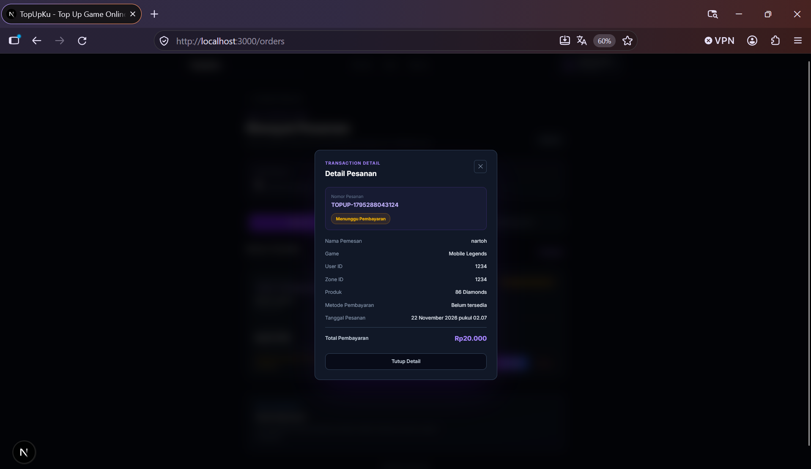

### Checkout

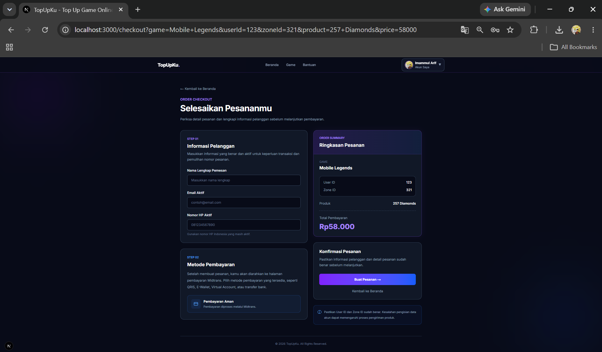

### Authentication

| Login | Registration |
|---|---|
|  |  |

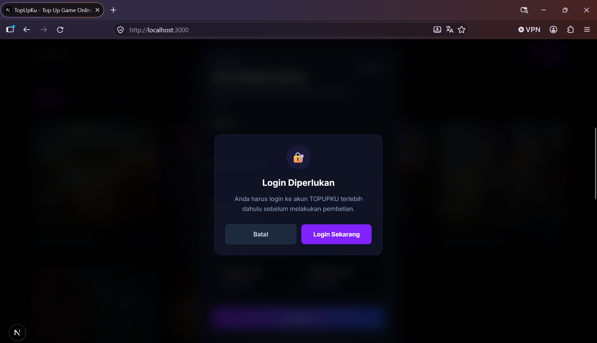

### Password Recovery

| Forgot Password | Password Reset |
|---|---|
| 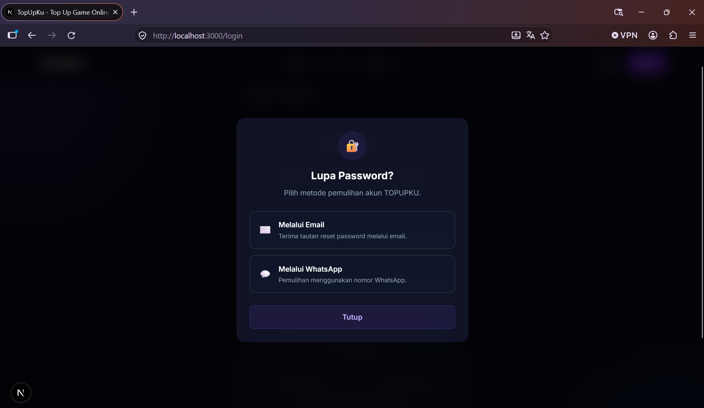 | 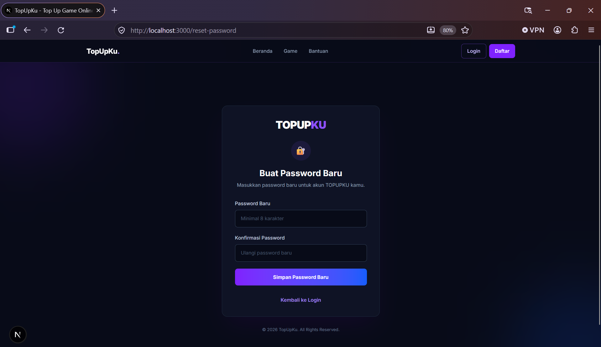 |

Email-based password recovery uses Supabase Auth. Its complete end-to-end flow remains pending verification.

### Order History


### Additional Interface

| How To | Footer |
|---|---|
|  |  |

---

## System Architecture

TOPUPKU is built using a full-stack architecture based on Next.js, Supabase, and external service integrations.

The application uses Next.js for frontend rendering and backend API processing. Supabase provides authentication, session management, and PostgreSQL database services.

Google OAuth is integrated through Supabase Auth to support Google account authentication. Midtrans provides payment processing through its Sandbox environment, while Resend handles email delivery for order recovery OTP.

Digiflazz is identified as the proposed game top-up provider for future automated fulfillment. Its integration has not yet started.

### Current and Planned Architecture

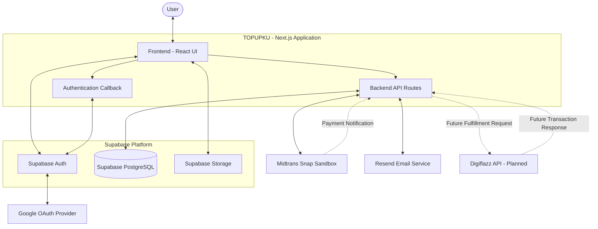

**Note:** Solid connections represent existing application integrations or components. Dashed connections represent proposed future integrations.

### Main Components

**Frontend**

- Homepage and game catalog.
- Authentication pages.
- Email and password login.
- Google OAuth login.
- Checkout interface.
- User profile and profile editing.
- Order history.
- Password recovery interface.

**Backend**

- Order processing.
- Product and price validation.
- Order history management.
- Payment notification handling.
- Order recovery OTP processing.
- Authentication callback handling.

**Supabase**

- PostgreSQL database.
- User authentication.
- OAuth provider integration.
- Session management.
- Application data storage.
- Storage services for supported file uploads.

**Google OAuth**

- Google account authentication.
- OAuth authorization and consent.
- Secure authentication flow through Supabase Auth.
- Redirect handling through the TOPUPKU authentication callback.

**Midtrans**

- Snap payment integration.
- Sandbox payment simulation.
- Payment notification integration.
- Future payment status synchronization.

**Digiflazz — Planned**

- Game product catalog integration.
- Product code and SKU mapping.
- Future automated game top-up requests.
- Future fulfillment status synchronization.

**Resend**

- Email delivery for the existing order recovery OTP functionality.

---

## System Workflows

This section describes the main application workflows, authentication processes, transaction lifecycle, and external service integrations within TOPUPKU.

### 1. User Journey Flow

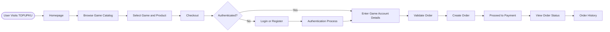

### 2. Authentication Flow

TOPUPKU supports email-password authentication and Google OAuth through Supabase Auth.

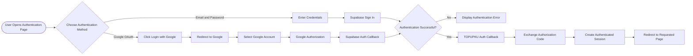

### 3. Order and Payment Flow — Current Implementation

```mermaid
flowchart LR
    A["Select Game"] --> B["Select Product"]
    B --> C["Enter Customer Information"]
    C --> D["Checkout"]
    D --> E["Server-side Validation"]
    E --> F{"Order Valid?"}

    F -->|No| G["Return Validation Error"]
    F -->|Yes| H[("Save Order in Supabase")]

    H --> I["Create Payment Request"]
    I --> J["Midtrans Snap Sandbox"]
    J --> K["User Completes Payment"]
    K --> L["Payment Notification"]
    L --> M["Webhook Signature Verification"]
    M --> N["Validate Payment Status"]
    N --> O[("Update Order Status")]
    O --> P["Display Updated Order Status"]
```

The backend validates order information and payment notifications before updating transaction status.

The integration has been implemented at the code level, but complete external notification delivery has not been verified.

This workflow does not include automated game item delivery.

### 4. Password Recovery Flow

```mermaid
flowchart LR
    A["Forgot Password"] --> B["Enter Registered Email"]
    B --> C["Supabase Password Reset Request"]
    C --> D["Send Recovery Email"]
    D --> E["User Opens Recovery Link"]
    E --> F["Authentication Callback"]
    F --> G["Establish Recovery Session"]
    G --> H["Reset Password Page"]
    H --> I["Enter New Password"]
    I --> J["Update Password"]
    J --> K["Return to Login"]
```

Email recovery has been implemented in the application interface. However, the complete recovery process remains pending successful verification.

WhatsApp recovery is not available.

### 5. Order Recovery Flow

This functionality allows users to recover order information using email OTP. It is separate from account authentication and password recovery.

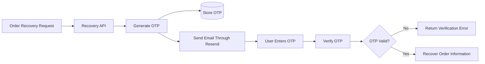

### 6. User Profile Flow

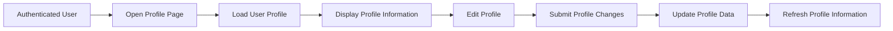

Profile editing is implemented. Custom profile image synchronization with the navigation bar may require further improvement.

### 7. Order Management Flow

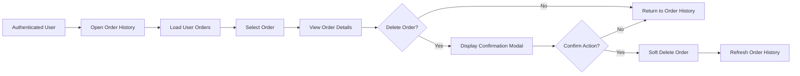

Order deletion uses soft-delete functionality. It hides the order from the user's history and does not represent cancellation of the underlying payment transaction.

---

## Planned Payment and Game Fulfillment Architecture

This section documents the proposed real-time payment processing and automated game top-up fulfillment architecture for future development.

The architecture is designed around two separate external providers:

- **Midtrans:** Payment gateway responsible for processing customer payments.
- **Digiflazz:** Game top-up provider responsible for processing and delivering purchased game products.

Both integrations are part of the future technical roadmap. Automated payment-to-fulfillment processing is not currently available.

### 1. Proposed End-to-End Transaction Flow

The following diagram illustrates the planned transaction lifecycle, from product selection to successful game credit delivery.

```mermaid
flowchart LR
    A([Customer]) --> B["Select Game"]
    B --> C["Select Top-Up Product"]
    C --> D["Enter Game Account Details"]
    D --> E["Checkout"]

    E --> F["Validate Product, Price and Account Data"]
    F --> G{"Order Valid?"}

    G -->|No| H["Display Validation Error"]
    G -->|Yes| I[("Create Order in Supabase")]

    I --> J["Set Order: PENDING_PAYMENT"]
    J --> K["Create Payment Request"]
    K --> L["Midtrans Snap"]

    L --> M["Customer Selects Payment Method"]
    M --> N["Complete Payment"]

    N --> O["Midtrans Payment Notification"]
    O --> P["Backend Webhook Verification"]
    P --> Q{"Payment Valid and Successful?"}

    Q -->|No| R["Update Payment Status"]
    Q -->|Yes| S["Update Payment: PAID"]

    S --> T["Queue Fulfillment Request"]
    T --> U["Send Order to Digiflazz API"]

    U --> V{"Provider Response"}

    V -->|Success| W["Update Fulfillment: SUCCESS"]
    V -->|Pending| X["Update Fulfillment: PROCESSING"]
    V -->|Failed| Y["Update Fulfillment: FAILED"]

    X --> Z["Check Provider Transaction Status"]
    Z --> V

    W --> AA["Update Customer Order History"]
    Y --> AB["Record Failure and Handle Recovery"]

    AA --> AC([Customer Receives Game Item])
```

### 2. Payment Processing Flow — Midtrans

Midtrans will handle the customer payment process.

Proposed responsibilities:

1. Create a payment transaction from a validated TOPUPKU order.
2. Generate a Midtrans Snap payment session.
3. Display available payment methods.
4. Allow customers to complete payment.
5. Receive payment notifications through a backend webhook.
6. Verify notification signatures and transaction information.
7. Validate order ID, transaction amount, and payment status.
8. Update the corresponding payment record in Supabase.

**Planned payment statuses:**

| Status | Description |
|---|---|
| PENDING | Waiting for customer payment |
| PAID | Payment successfully verified |
| FAILED | Payment failed |
| EXPIRED | Payment session expired |
| CANCELLED | Payment cancelled |
| REFUNDED | Payment refunded |

Payment status must be determined by verified server-side information, not solely by the customer's browser redirect.

### 3. Game Top-Up Fulfillment Flow — Digiflazz

After a payment has been successfully verified, TOPUPKU will initiate the game top-up fulfillment process through Digiflazz.

Proposed responsibilities:

1. Retrieve or synchronize available game products.
2. Match TOPUPKU products with provider product codes or SKUs.
3. Validate product pricing and availability.
4. Submit the customer game account information.
5. Send a fulfillment request through the Digiflazz API.
6. Receive the provider's transaction response.
7. Track the fulfillment transaction status.
8. Update the corresponding order in Supabase.
9. Display the final result to the customer.

**Planned fulfillment statuses:**

| Status | Description |
|---|---|
| QUEUED | Waiting for fulfillment processing |
| PROCESSING | Provider is processing the request |
| SUCCESS | Game top-up successfully delivered |
| FAILED | Fulfillment failed |
| PENDING | Provider response is not yet final |

A successful payment does not automatically indicate successful game delivery. Payment and fulfillment must be tracked independently.

### 4. Payment and Fulfillment Synchronization

TOPUPKU will use separate payment and fulfillment states to prevent confusion between financial transactions and game delivery.

Example transaction lifecycle:

```text
ORDER CREATED
      |
      v
PENDING PAYMENT
      |
      v
PAYMENT VERIFIED
      |
      v
PAYMENT PAID
      |
      v
FULFILLMENT QUEUED
      |
      v
DIGIFLAZZ PROCESSING
      |
      v
FULFILLMENT SUCCESS
      |
      v
ORDER COMPLETED
```

If fulfillment fails or remains pending, the system must retain the payment record and provide a controlled recovery process.

A failed fulfillment after successful payment must not automatically be treated as an unpaid order.

### 5. Planned Transaction Security and Reliability

The future implementation should consider:

- Server-side payment verification.
- Webhook signature verification.
- Idempotent payment notification processing.
- Idempotent fulfillment request handling.
- Unique transaction references.
- Server-side price and product validation.
- Duplicate top-up prevention.
- Provider transaction status reconciliation.
- Secure API credential management.
- Transaction logging and error handling.
- Controlled retry and recovery mechanisms.

The system must never submit duplicate game top-up requests because of repeated webhook notifications or temporary network failures.

For uncertain provider responses, the system should check the original transaction status before attempting another fulfillment request.

### 6. Planned External Service Architecture

| Provider | Responsibility | Status |
|---|---|---|
| Midtrans | Customer payment processing | Sandbox integration implemented; pending end-to-end verification |
| Digiflazz | Game product supply and fulfillment | Planned |
| Supabase | Authentication, database and transaction records | Implemented |
| Next.js | Frontend and backend API processing | Implemented |
| Resend | Order recovery email delivery | Implemented; verification as documented |

**Implementation Note:** Digiflazz API credentials, product synchronization, fulfillment endpoints, and provider status handling will be evaluated during the future integration phase. Actual API behavior and available callback mechanisms must be verified against the provider's official documentation before implementation.

---

## Technology Stack

| Category | Technology |
|---|---|
| Framework | Next.js 16 |
| UI Library | React 19 |
| Programming Language | TypeScript |
| Styling | Tailwind CSS v4 |
| Database | Supabase PostgreSQL |
| Authentication | Supabase Auth |
| Payment Gateway | Midtrans Snap |
| Game Top-Up Provider | Digiflazz (Planned) |
| Email Service | Resend |
| Package Manager | npm |
| Version Control | Git |
| Repository Hosting | GitHub |
| Development Environment | Visual Studio Code |

---

## API Endpoints

### Current API Endpoints

| Method | Endpoint | Description |
|---|---|---|
| POST | `/api/orders` | Create an order |
| GET | `/api/orders` | Retrieve order history |
| DELETE | `/api/orders` | Hide an order from user history |
| POST | `/api/orders/recovery/request` | Request order recovery OTP |
| POST | `/api/orders/recovery/verify` | Verify order recovery OTP |
| POST | `/api/midtrans/notification` | Receive payment notifications |

Order deletion uses a soft-delete approach. It hides the order from the user's history and does not automatically cancel an external payment or remove the underlying transaction record.

### Future API Considerations

The following are conceptual responsibilities, not existing endpoints.

| Proposed Function | Purpose |
|---|---|
| Product synchronization | Retrieve and update game product catalog |
| Fulfillment request | Submit paid orders to Digiflazz |
| Fulfillment callback/status | Receive or retrieve provider transaction updates |
| Transaction reconciliation | Compare local and provider transaction statuses |

Actual endpoint paths and implementation details will be determined after reviewing official provider documentation.

---

## Database

TOPUPKU uses Supabase PostgreSQL for application data storage.

### Known Application Tables

| Table | Purpose |
|---|---|
| `orders` | Stores order and transaction information |
| `order_recovery_otps` | Stores order recovery OTP information |

User authentication is managed separately through Supabase Auth.

### Proposed Future Database Structure

The future payment and fulfillment architecture may require separating order, payment, and fulfillment records.

| Proposed Table | Purpose |
|---|---|
| `payments` | Stores payment provider references, amounts, and payment statuses |
| `fulfillments` | Stores game provider references, product information, and fulfillment statuses |

These tables are proposed design considerations and have not been confirmed as existing database structures.

The final database design will depend on the current `orders` schema, transaction relationships, security requirements, and provider integration behavior.

---

## Project Structure

```text
topupku/
├── app/
│   ├── api/
│   │   ├── midtrans/
│   │   │   └── notification/
│   │   └── orders/
│   │       └── recovery/
│   ├── auth/
│   │   └── callback/
│   ├── checkout/
│   ├── login/
│   ├── orders/
│   ├── profile/
│   │   └── edit/
│   ├── register/
│   └── reset-password/
├── components/
├── docs/
│   └── screenshots/
├── lib/
│   └── supabase/
├── proxy.ts
├── package.json
└── README.md
```

---

## Getting Started

### Requirements

- Node.js
- npm
- Supabase project
- Midtrans Sandbox account
- Resend account (for existing order recovery email functionality)

Digiflazz is not required for the current local development setup because its integration is planned for a future development phase.

### Installation

```bash
git clone https://github.com/imammularif/topupku.git

cd topupku

npm install
```

### Environment Variables

Create a `.env.local` file in the project root.

```env
NEXT_PUBLIC_SUPABASE_URL=
NEXT_PUBLIC_SUPABASE_ANON_KEY=

SUPABASE_URL=
SUPABASE_SECRET_KEY=

MIDTRANS_SERVER_KEY=
MIDTRANS_SIGNATURE_SECRET_KEY=
NEXT_PUBLIC_MIDTRANS_CLIENT_KEY=
MIDTRANS_IS_PRODUCTION=false

RESEND_API_KEY=
RESEND_FROM_EMAIL=

ORDER_OTP_SECRET=
```

Use your own credentials from the respective service providers.

**Security Notes**

- Never commit `.env.local` to GitHub.
- Keep server-side secrets private.
- Never expose Supabase secret keys or Midtrans Server Key in client-side code.
- Use Sandbox credentials during development.
- Do not share API keys, access tokens, or other credentials publicly.

### Run Locally

```bash
npm run dev
```

Open:

```text
http://localhost:3000
```

### Type Checking

```bash
npm run typecheck
```

---

## Verification and Testing

Latest recorded verification checkpoint: November 22, 2026.

| Check | Status |
|---|---|
| TypeScript type checking | Passed |
| Git working tree after push | Clean |
| GitHub synchronization | Passed |
| Git push | Passed |
| Password recovery email delivery | Rate limited during testing |
| Password update through recovery session | Pending verification |
| Midtrans end-to-end payment | Not verified |
| Public webhook integration | Not verified |
| Digiflazz integration | Not started |
| Automated game fulfillment | Not implemented |
| Production deployment | Not performed |

A successful TypeScript check confirms that the application passes the configured type checking process. It does not guarantee that all external services or production integrations work correctly.

---

## Limitations

- The application is not operating commercially.
- Midtrans is used in Sandbox mode.
- Automated game credit fulfillment is not implemented.
- Digiflazz API integration has not started.
- Public webhook integration testing remains pending.
- Password recovery has not completed end-to-end verification.
- Google OAuth end-to-end verification remains pending.
- Apple ID and WhatsApp authentication/recovery are not implemented.
- Automated testing and production monitoring are not yet implemented.
- Additional security and deployment work is required before any production launch.
- The proposed payment-to-fulfillment architecture is not an operational transaction system.

---

## Roadmap

The following roadmap represents the current project direction and potential future development. It does not represent an active development schedule.

### Phase 1 — Core Application Development

- [x] Homepage and game catalog.
- [x] Authentication and profile management.
- [x] Order creation and order history.
- [x] Order recovery OTP functionality.
- [x] Midtrans Snap Sandbox integration.
- [x] Payment notification endpoint implementation.
- [x] Login-required checkout protection.
- [x] Order history soft deletion.
- [x] Forgot password interface.
- [x] Password reset page.
- [ ] Complete outstanding authentication and payment verification.

### Phase 2 — Technical Knowledge and Architecture Planning

- [ ] Study payment gateway transaction lifecycles.
- [ ] Study Midtrans notification and webhook handling.
- [ ] Study Digiflazz API documentation.
- [ ] Understand game product codes and SKU mapping.
- [ ] Design automated game fulfillment architecture.
- [ ] Study payment and fulfillment status synchronization.
- [ ] Design transaction idempotency and duplicate prevention.
- [ ] Document transaction failure and recovery scenarios.
- [ ] Plan database relationships for orders, payments, and fulfillments.

### Phase 3 — Future Payment and Game Top-Up Integration

- [ ] Complete Midtrans payment verification.
- [ ] Integrate Digiflazz API.
- [ ] Implement game product synchronization.
- [ ] Implement automated game top-up fulfillment.
- [ ] Implement payment-to-fulfillment synchronization.
- [ ] Implement transaction status monitoring.
- [ ] Implement failure handling and transaction reconciliation.

### Phase 4 — Production Readiness

- [ ] Complete end-to-end integration testing.
- [ ] Conduct application security review.
- [ ] Implement automated testing.
- [ ] Configure production monitoring and logging.
- [ ] Perform production deployment.
- [ ] Evaluate commercial operational requirements.

Future implementation phases will be considered when sufficient time, resources, and professional circumstances allow.

---

## Development Hiatus

TOPUPKU is currently in a temporary development hiatus.

This decision reflects the project's current development limitations and the need to prioritize professional stability.

The developer is focusing on securing employment in Jakarta, prioritizing sustainable career opportunities, clear employment continuation prospects, and long-term stability over uncertain short-term contracts.

Further TOPUPKU development will be considered when sufficient time, resources, and professional circumstances allow.

During this period, the project may remain in a knowledge-gathering and technical planning phase. No active implementation of the planned Digiflazz integration or automated game fulfillment is scheduled.

The current source code, implementation progress, and documentation remain preserved in this GitHub repository.

**Project status: Temporarily Paused.**

**Development checkpoint: November 22, 2026.**

---

## Author

**Imammul Arif**

- GitHub: [github.com/imammularif](https://github.com/imammularif)
- Portfolio: [imammularif.github.io/portfolio-V2.0](https://imammularif.github.io/portfolio-V2.0)

---

## Disclaimer

TOPUPKU is an independent personal learning, software development, and business concept project.

It is not affiliated with, sponsored by, or officially endorsed by any game publisher, payment provider, or third-party service mentioned in this repository.

All trademarks, product names, and brand names belong to their respective owners.
