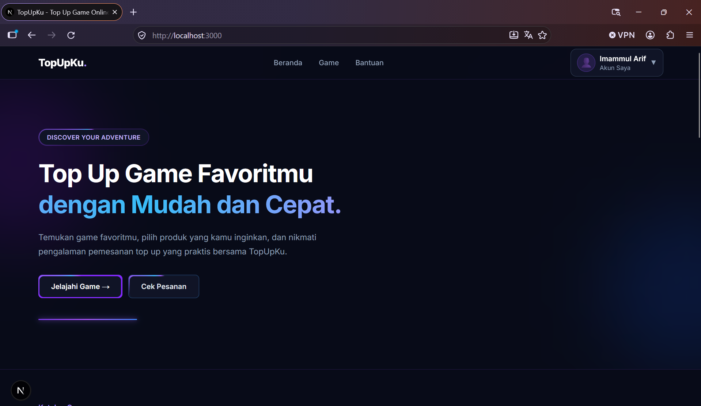
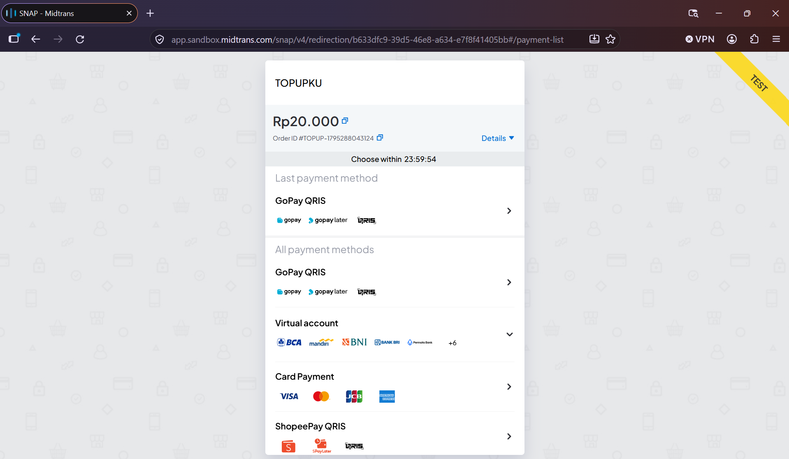
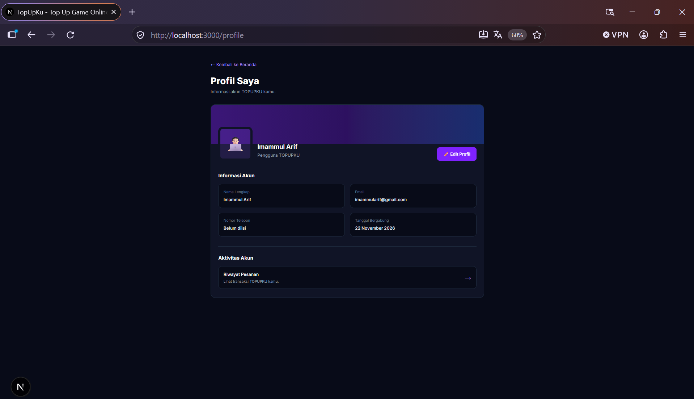
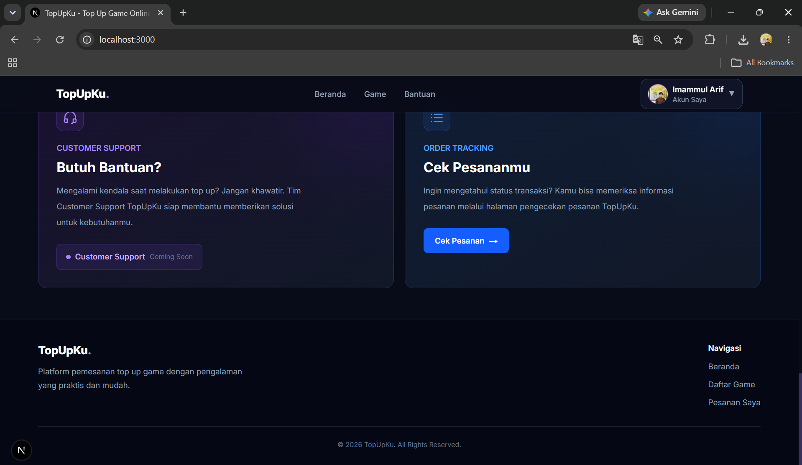

# TOPUPKU

A personal game top-up web application built as a full-stack development and learning project.

## Project Status

**Temporarily On Hold — November 2026**

TOPUPKU is maintained as a personal portfolio project. Development is temporarily paused while the developer focuses on career opportunities.

The application is not operating commercially. Production deployment, live payment processing, and automated game credit delivery have not been completed.

## Overview

TOPUPKU simulates an online game top-up purchasing experience.

The project demonstrates full-stack development through user authentication, product selection, order management, database integration, payment gateway integration, and email-based order recovery.

## Features

### Implemented

- [x] Homepage and game catalog
- [x] Game and product selection
- [x] Checkout and customer information form
- [x] User registration and login
- [x] Supabase authentication
- [x] User profile and profile editing
- [x] Order creation and order history
- [x] Server-side product and price validation
- [x] Order recovery through email OTP
- [x] Midtrans Snap integration
- [x] Midtrans notification endpoint and signature verification
- [x] Order and payment status validation

### Pending

- [ ] End-to-end Midtrans webhook testing through a public HTTPS endpoint
- [ ] Complete payment flow verification
- [ ] Automated game credit delivery
- [ ] Automated testing
- [ ] Production deployment and monitoring

## Screenshots

### Homepage

| Before Login | After Login |
|---|---|
|  |  |

### Catalog and Checkout


### Payment

| Payment Simulation | QRIS Simulation |
|---|---|
|  |  |

### Authentication and Profile

| Login | Registration |
|---|---|
|  |  |

| Profile | Edit Profile |
|---|---|
|  |  |


### Additional Pages




## Technology Stack

| Category | Technology |
|---|---|
| Framework | Next.js |
| UI | React |
| Language | TypeScript |
| Styling | Tailwind CSS |
| Database | Supabase PostgreSQL |
| Authentication | Supabase Auth |
| Payment | Midtrans Snap |
| Email | Resend |
| Tools | npm, Git, GitHub, VS Code |

## System Architecture

TOPUPKU uses Next.js for frontend pages and backend API routes.

```text
                  USER
                    |
                    v
             NEXT.JS APPLICATION
                    |
          +---------+---------+
          |                   |
          v                   v
       FRONTEND             BACKEND
          |                   |
          v                   v
     USER INTERFACE       API ROUTES
                              |
                +-------------+-------------+
                |             |             |
                v             v             v
             SUPABASE      MIDTRANS       RESEND
                |             |             |
                v             v             v
             DATABASE     PAYMENT         EMAIL
             AUTH         GATEWAY         DELIVERY
```

**Main services:**

- **Next.js:** Frontend and backend application.
- **Supabase:** Database and authentication.
- **Midtrans:** Payment gateway.
- **Resend:** Email delivery.

## Main Workflows

### Authentication

1. Users register or log in.
2. Supabase Auth manages authentication.
3. The application handles authentication callbacks.
4. Authenticated users can access their profile and order history.

### Order and Payment

1. Users select a game and product.
2. Users enter customer information.
3. The backend validates the product and price.
4. The order is stored in Supabase.
5. Payment is initiated through Midtrans Snap.
6. Midtrans sends a notification to the application.
7. The webhook validates the transaction before updating the order status.

**Webhook status:** Implemented and passed code-level checks. End-to-end notification delivery has not yet been verified through a public HTTPS endpoint.

## API Endpoints

| Method | Endpoint | Description |
|---|---|---|
| POST | `/api/orders` | Create an order |
| GET | `/api/orders` | Retrieve orders |
| POST | `/api/orders/recovery/request` | Request recovery OTP |
| POST | `/api/orders/recovery/verify` | Verify recovery OTP |
| POST | `/api/midtrans/notification` | Receive payment notifications |

## Database

The application uses Supabase PostgreSQL.

Known application tables:

- `orders` — order and transaction information.
- `order_recovery_otps` — OTP data for order recovery.

User authentication is managed through Supabase Auth.

## Project Structure

```text
topupku/
├── app/
│   ├── api/
│   │   ├── midtrans/
│   │   └── orders/
│   ├── auth/
│   ├── checkout/
│   ├── login/
│   ├── orders/
│   ├── profile/
│   └── register/
├── components/
├── docs/
│   └── screenshots/
├── lib/
│   └── supabase/
├── proxy.ts
├── package.json
└── README.md
```

## Getting Started

### Requirements

- Node.js
- npm
- Supabase project
- Midtrans Sandbox account
- Resend account

### Installation

```bash
git clone https://github.com/imammularif/topupku.git
cd topupku
npm install
```

### Environment Variables

Create a `.env.local` file in the project root:

```env
NEXT_PUBLIC_SUPABASE_URL=
NEXT_PUBLIC_SUPABASE_ANON_KEY=

SUPABASE_URL=
SUPABASE_SECRET_KEY=

MIDTRANS_SERVER_KEY=
MIDTRANS_SIGNATURE_SECRET_KEY=
NEXT_PUBLIC_MIDTRANS_CLIENT_KEY=
MIDTRANS_IS_PRODUCTION=false

RESEND_API_KEY=
RESEND_FROM_EMAIL=

ORDER_OTP_SECRET=
```

Use your own credentials from each service.

**Security:**
- Never commit `.env.local` to GitHub.
- Keep server-side secrets private.
- Never expose Supabase secret keys or Midtrans Server Key in client-side code.
- Use Sandbox credentials during development.

### Run Locally

```bash
npm run dev
```

Open [http://localhost:3000](http://localhost:3000).

## Verification

| Check | Result |
|---|---|
| TypeScript type checking | Passed |
| Production build | Passed |
| Midtrans notification route ESLint | Passed |
| Full-project ESLint | Outstanding issues |
| Midtrans end-to-end testing | Not verified |
| Production deployment | Not performed |

The full-project ESLint check has reported existing React Hooks and image optimization issues.

A successful build confirms compilation, but does not guarantee that external integrations work correctly in production.

## Limitations

- Not operating as a commercial service.
- Production payment processing is not enabled.
- Automated top-up fulfillment is not implemented.
- Public webhook integration testing is pending.
- Automated testing and production monitoring are not available.
- Further security and deployment work is required before production use.

## Roadmap

- [x] Core application and game catalog
- [x] Authentication and profile management
- [x] Order management and recovery
- [x] Midtrans Snap integration
- [x] Payment notification endpoint
- [ ] End-to-end payment verification
- [ ] Automated testing and security review
- [ ] Production deployment
- [ ] Automated top-up fulfillment

## Author

**Imammul Arif**

- GitHub: [github.com/imammularif](https://github.com/imammularif)
- Portfolio: [imammularif.github.io/portfolio-V2.0](https://imammularif.github.io/portfolio-V2.0)

## Disclaimer

TOPUPKU is an independent personal learning and portfolio project. It is not affiliated with or officially endorsed by any game publisher or third-party service mentioned in this repository.

All trademarks and product names belong to their respective owners.
