# TopUpKu — Game Top-Up Website

A game top-up website prototype built with **Next.js, TypeScript, and Supabase**.

TopUpKu is designed to provide a simple and user-friendly experience for browsing game products, placing top-up orders, and tracking order history.

> **Project Status:** Functional prototype — Order management and email-based order recovery are integrated with Supabase and Resend. Payment gateway and official game top-up provider integrations are not yet implemented.

## Screenshots

### Homepage


### Game Selection
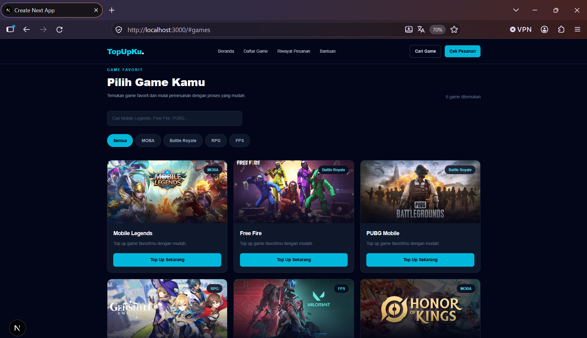

### Checkout Page
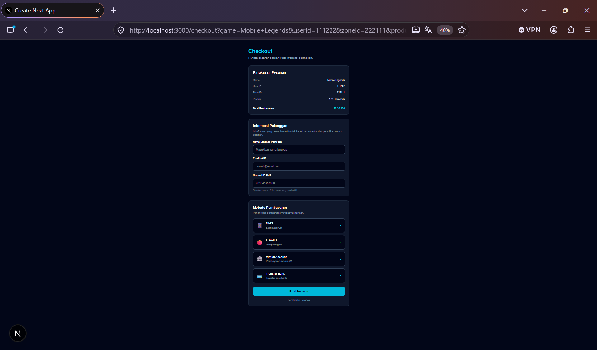

### Order History
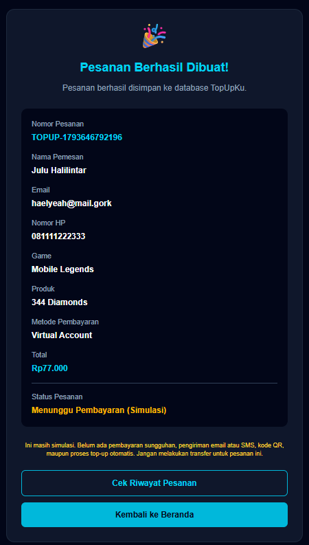

### Search History
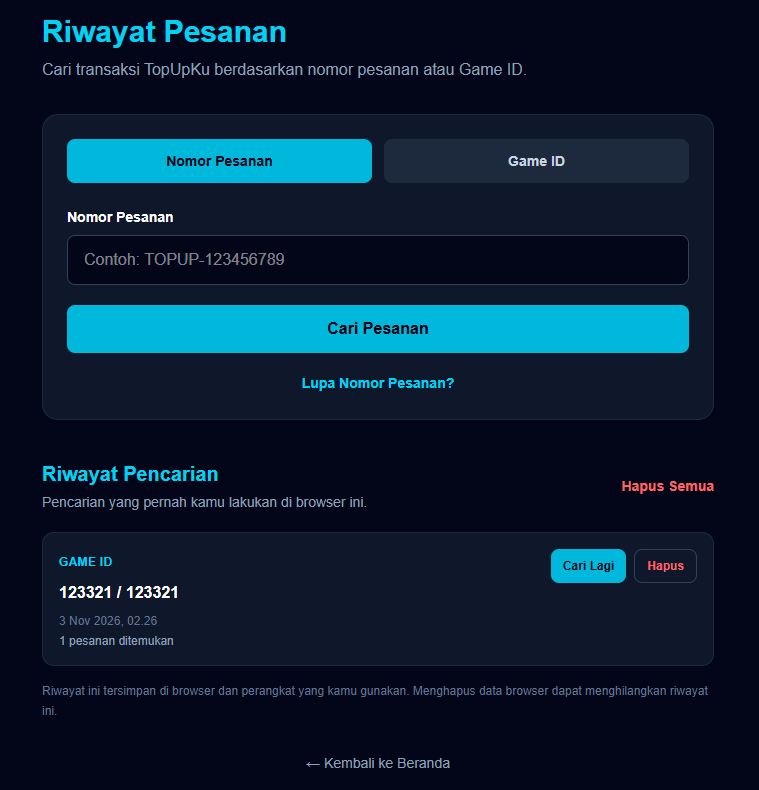
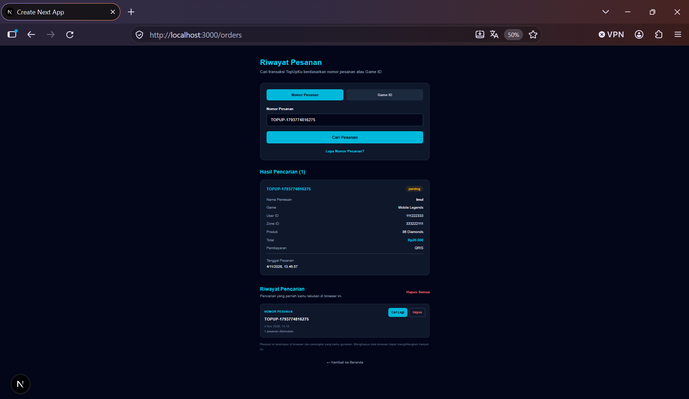

Users can review their previous searches, repeat a search, and manage their local search history.

### Forgot Order Number
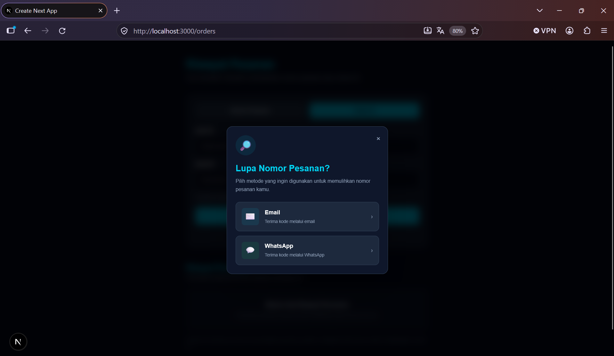

An order number recovery feature that allows users to recover previous order numbers using email verification.

WhatsApp recovery is displayed as a future feature and is currently unavailable.

### Email Recovery
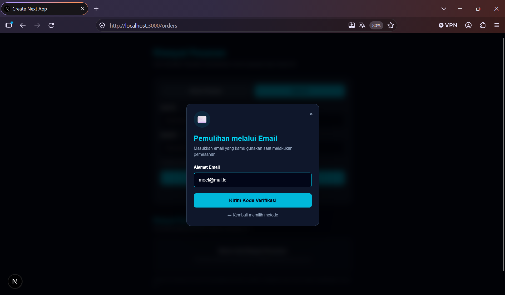
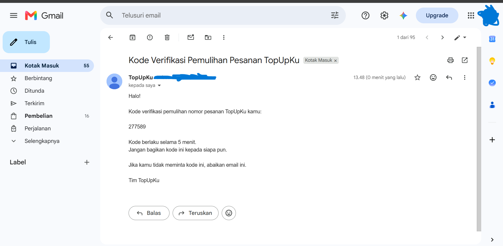


Users can request an order recovery verification code using their registered email address.

The backend checks whether the email is associated with existing order records before processing the recovery request.

### OTP Verification
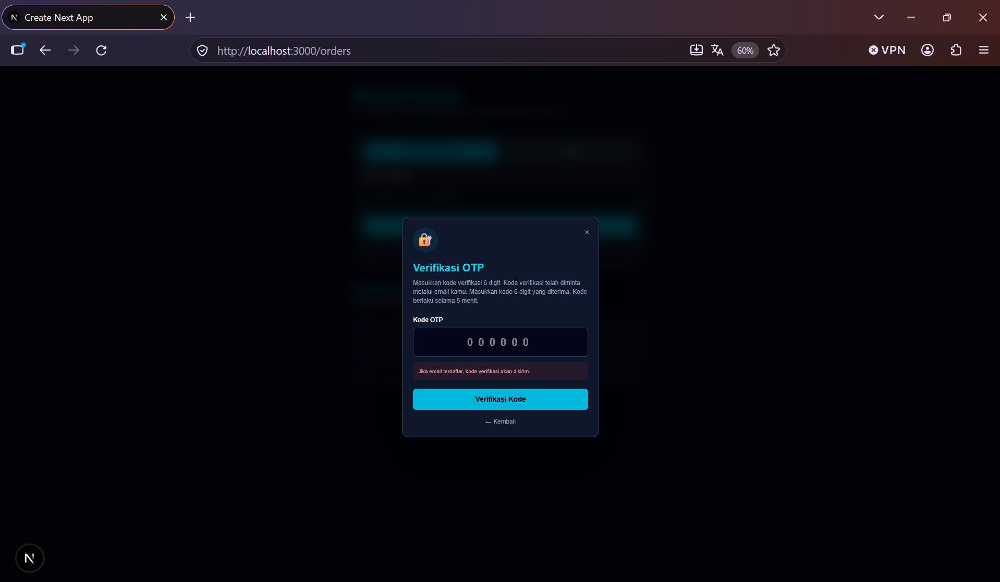
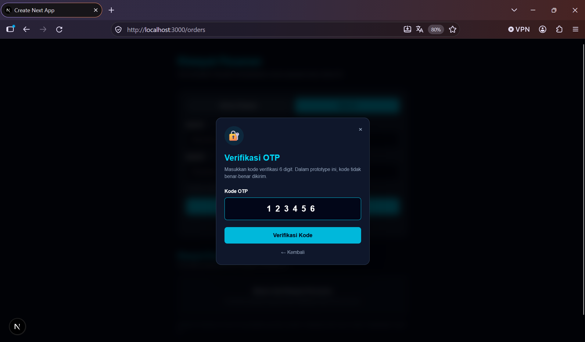

An email-based OTP verification process integrated with the Resend email service.

- Six-digit verification code.
- OTP expiration after 5 minutes.
- Email-based verification through backend API routes.
- OTP values are hashed before being stored in Supabase.
- Verification attempts are limited to help prevent repeated guessing.

### Recovery Result
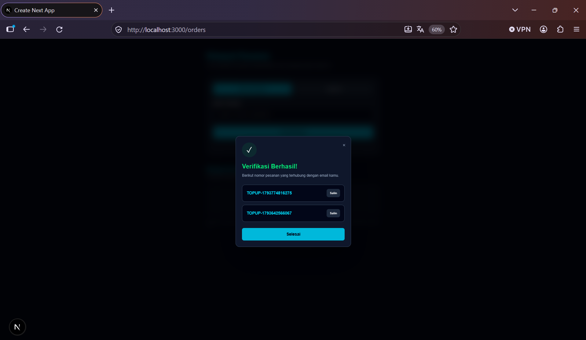

After successful OTP verification, the system retrieves and displays order numbers associated with the verified email address.

Users can copy their recovered order numbers directly from the result interface.

### Email Notification

The order recovery process uses Resend to deliver verification emails.

The email notification includes:

- TopUpKu branding.
- A six-digit OTP verification code.
- Verification expiration information.
- Instructions for completing the recovery process.

### Backend Integration

The order recovery feature is connected to:

- **Supabase:** Stores order records and OTP verification data.
- **PostgreSQL:** Stores order and recovery records.
- **Resend:** Handles email delivery.
- **Next.js API Routes:** Processes OTP requests, verification, and order number retrieval.

### Feature Notes

- Email-based OTP recovery is implemented and integrated with the backend.
- Email delivery to arbitrary customer addresses requires a verified sending domain in Resend.
- WhatsApp recovery is not yet available.
- Order numbers are displayed only after successful OTP verification.
- Recovery requests use generic responses to avoid revealing whether an email address is registered.

## Features

- Game selection and product catalog.
- Game account details input (User ID and Zone ID).
- Product selection and checkout flow.
- Simulated payment method selection:
  - QRIS
  - E-Wallet
  - Virtual Account
  - Bank Transfer
- Order creation and order history management.
- Order lookup by order number or game account details.
- Search history management.
- Forgot order number interface.
- Email-based OTP order recovery.
- OTP verification and expiration handling.
- Recovered order number display and copy functionality.

### Planned Product Expansion

TopUpKu is designed as a prototype that can be extended to support various digital products, including:

- **Game Currency:** Diamonds, UC, Genesis Crystals, Valorant Points, and other in-game currencies.
- **Game Membership:** Weekly Pass, Monthly Card, and other game subscriptions.
- **Game Vouchers:** Digital game vouchers and prepaid codes.
- **Digital Gift Cards:** Steam Wallet, Google Play, PlayStation Store, and other digital gift cards.
- **Gaming Subscriptions:** PlayStation Plus, Xbox Game Pass, and other gaming subscriptions.

## Tech Stack

| Technology | Purpose |
|---|---|
| Next.js 16 | React framework and API routes |
| React | User interface |
| TypeScript | Type-safe development |
| Tailwind CSS | Styling |
| Supabase | Backend and database integration |
| PostgreSQL | Relational data storage |
| Resend | Transactional email delivery |
| Git & GitHub | Version control |

## Supported Games

- Mobile Legends
- Free Fire
- PUBG Mobile
- Genshin Impact
- Valorant
- Honor of Kings

## Payment Methods (Prototype)

The checkout interface currently provides simulated payment method selection:

- QRIS
- E-Wallet
- Virtual Account
- Bank Transfer

**Note:** These payment methods are UI simulations only. No real transactions or payment processing are performed.

## Getting Started

### Prerequisites

Make sure you have installed:

- Node.js
- npm
- Git

You also need:

- A Supabase project.
- A Resend account for email-based OTP delivery.

### 1. Clone the repository

```bash
git clone https://github.com/imammularif/topupku.git
```

### 2. Navigate to the project directory

```bash
cd topupku
```

### 3. Install dependencies

```bash
npm install
```

### 4. Configure environment variables

Create a `.env.local` file in the project root:

```env
SUPABASE_URL=your_supabase_project_url
SUPABASE_SECRET_KEY=your_supabase_secret_key

RESEND_API_KEY=your_resend_api_key
RESEND_FROM_EMAIL=TopUpKu <onboarding@resend.dev>

ORDER_OTP_SECRET=your_random_32_byte_secret
```

Replace the placeholder values with your own credentials.

**Important:**

- `SUPABASE_SECRET_KEY` must only be used in server-side code.
- `RESEND_API_KEY` must never be exposed in client-side code.
- `ORDER_OTP_SECRET` should be a strong, randomly generated secret.
- The Resend testing sender can only send to the account owner's verified email address. A verified sending domain is required to send emails to arbitrary customer addresses.
- Never commit your `.env.local` file or expose secret keys in your repository.

### 5. Configure the database

TopUpKu uses Supabase PostgreSQL.

Create the required database tables:

- `orders` — Stores customer order information.
- `order_recovery_otps` — Stores hashed OTP verification records and expiration information.

Enable Row Level Security (RLS) and configure appropriate permissions for database access.

The recovery API uses server-side Supabase credentials to access the required records.

### 6. Run the development server

```bash
npm run dev
```

Open [http://localhost:3000](http://localhost:3000) in your browser.

### 7. Production build

```bash
npm run build
```

## Database

TopUpKu uses Supabase with PostgreSQL to store order and recovery information.

### Orders Table

The `orders` table includes:

- Order ID
- Order code
- Customer name
- Customer email
- Customer phone
- Game
- User ID
- Zone ID
- Product
- Price
- Payment method
- Order status
- Creation timestamp

### Order Recovery OTP Table

The `order_recovery_otps` table includes:

- Recovery record ID
- Customer email
- Hashed OTP
- Expiration timestamp
- Verification attempt counter
- OTP consumption timestamp
- Creation timestamp

OTP records are used to support the email-based order recovery process.

## Project Structure

```text
topupku/
├── app/
│   ├── api/
│   │   └── orders/
│   │       ├── recovery/
│   │       │   ├── request/
│   │       │   │   └── route.ts
│   │       │   └── verify/
│   │       │       └── route.ts
│   │       └── route.ts
│   ├── checkout/
│   │   └── page.tsx
│   ├── orders/
│   │   └── page.tsx
│   ├── globals.css
│   ├── layout.tsx
│   └── page.tsx
├── lib/
│   └── supabaseAdmin.ts
├── public/
│   └── games/
├── docs/
│   └── screenshots/
├── .env.local
├── package.json
└── README.md
```

## Current Limitations

TopUpKu is currently a functional prototype for learning and portfolio purposes.

- Payment methods are simulated and do not process actual payments.
- No real QRIS, e-wallet, or virtual account transactions are performed.
- Order fulfillment is not connected to an official game top-up provider.
- Order status remains pending unless updated separately.
- Email-based OTP recovery is implemented, but customer-facing email delivery requires a verified Resend domain.
- WhatsApp recovery is not yet available.
- Search history is stored locally in the browser and is not synchronized across devices.
- Public order lookup endpoints are intended for prototype testing only.

Additional authentication, authorization, API rate limiting, and privacy protections are required before production deployment.

## Roadmap

### Completed

- [x] Homepage and game catalog
- [x] Game selection interface
- [x] Checkout page
- [x] Supabase database integration
- [x] Order creation API
- [x] Order history page
- [x] Search history
- [x] Order recovery interface
- [x] Email-based OTP request API
- [x] OTP verification API
- [x] Supabase OTP storage
- [x] Resend email service integration
- [x] Recovered order number display
- [x] GitHub repository

### Future Development Plans

**Code Quality & Security**

- [ ] Code refactoring and improved project structure
- [ ] Improved order code generation
- [ ] API security and data protection improvements
- [ ] IP-based rate limiting and abuse prevention
- [ ] Customer authentication
- [ ] Secure order lookup and verification

**Product Catalog Expansion**

- [ ] Expand the catalog beyond game diamonds and currencies
- [ ] Add game memberships and subscription products
- [ ] Add digital game vouchers and gift cards
- [ ] Support more games and digital products

**Payment & Order Management**

- [ ] Integrate a real payment gateway
- [ ] Implement real payment verification and webhooks
- [ ] Implement real-time order status updates
- [ ] Implement automated order fulfillment

**Integration & Deployment**

- [ ] Verify a custom sending domain for Resend
- [ ] Complete end-to-end email recovery testing
- [ ] Integrate official game top-up providers
- [ ] Integrate digital product providers
- [ ] Production deployment

## Disclaimer

TopUpKu is an independent learning and portfolio project.

Payment processing and game top-up fulfillment are not available for real transactions.

This project is not affiliated with or officially endorsed by the game publishers mentioned above.

## Author

**Imammul Arif**

GitHub: [@imammularif](https://github.com/imammularif)

Project Repository: [TopUpKu](https://github.com/imammularif/topupku)

Portfolio: [imammularif.github.io/portfolio-V2.0](https://imammularif.github.io/portfolio-V2.0)
