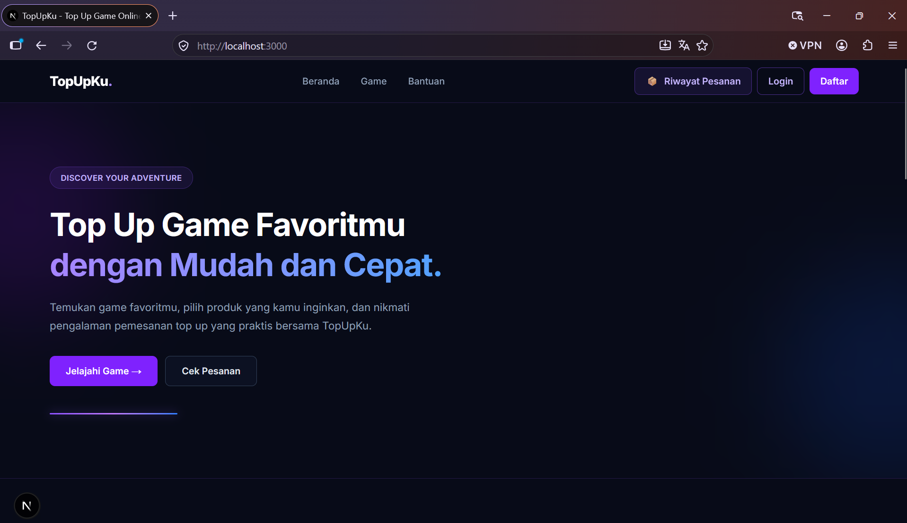
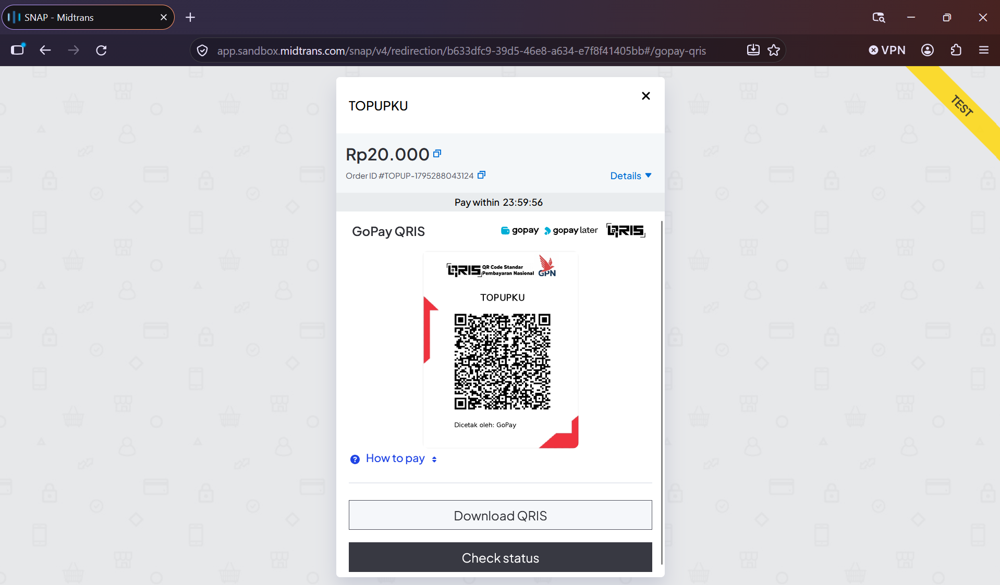
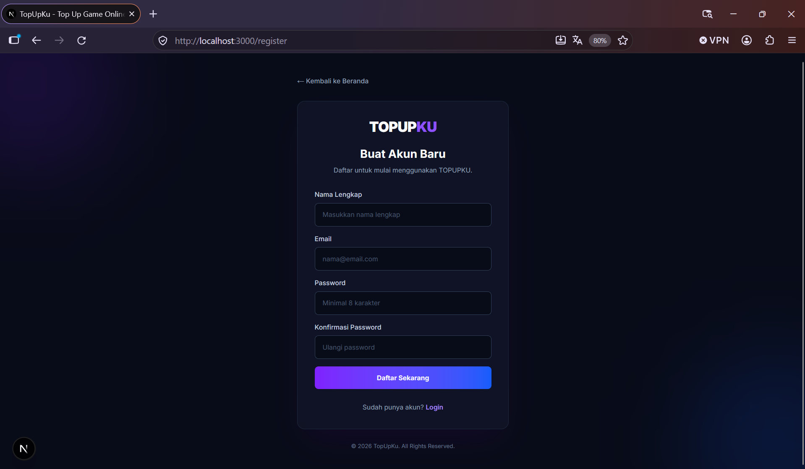
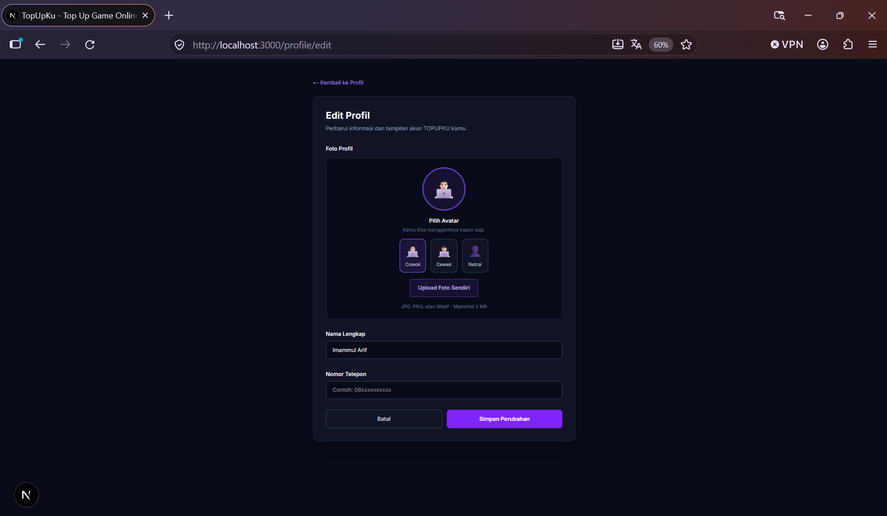
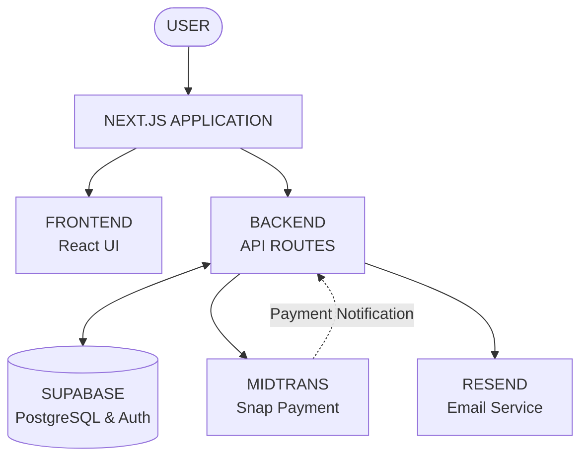
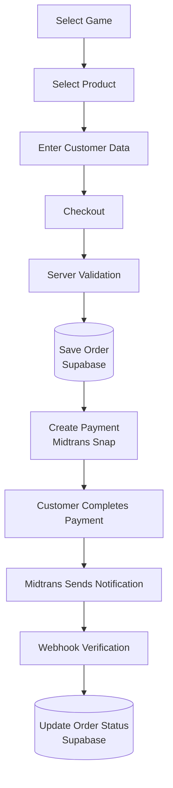
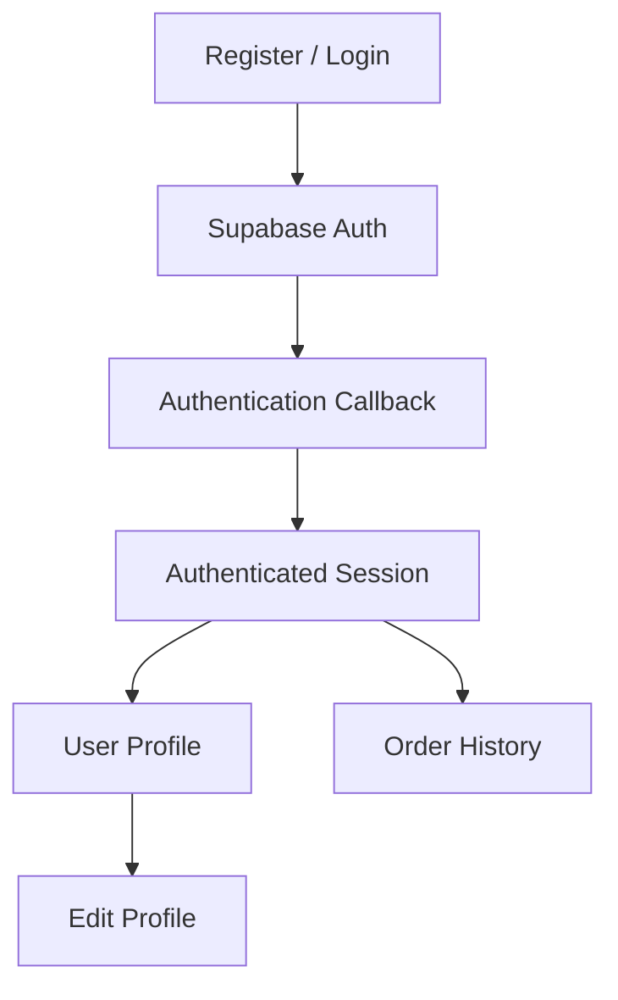
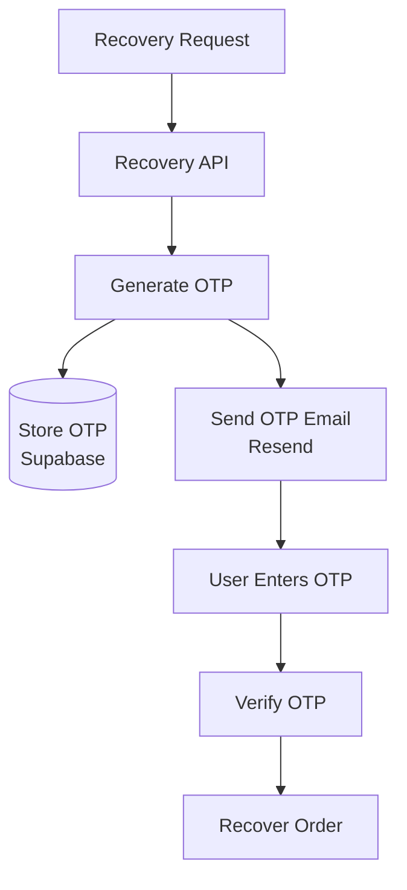

# TOPUPKU

A personal game top-up web application built as a full-stack development and learning project.

## Project Status

**Temporarily On Hold — November 2026**

TOPUPKU is a personal portfolio project. Development is temporarily paused while the developer focuses on career opportunities and professional growth.

The application is not operating commercially. Production deployment, live payment processing, and automated game credit delivery are not yet available.

## Overview

TOPUPKU simulates an online game top-up purchasing experience.

The project explores full-stack development through authentication, product selection, order management, database integration, payment gateway integration, and email-based order recovery.

## Features

### Implemented

- [x] Homepage and game catalog
- [x] Game and product selection
- [x] Checkout and customer information form
- [x] User registration and login
- [x] Supabase authentication
- [x] User profile and profile editing
- [x] Order creation and order history
- [x] Server-side product and price validation
- [x] Order recovery using email OTP
- [x] Midtrans Snap integration
- [x] Payment notification endpoint
- [x] Webhook signature verification implementation
- [x] Payment status validation

### Pending

- [ ] Public HTTPS webhook integration testing
- [ ] End-to-end payment flow verification
- [ ] Automated game credit delivery
- [ ] Automated testing
- [ ] Production deployment and monitoring

## Screenshots

### Homepage




### Game Catalog and Checkout


### Payment




### Authentication and Profile








### Additional Pages


## Technology Stack

| Category | Technology |
|---|---|
| Framework | Next.js |
| UI Library | React |
| Language | TypeScript |
| Styling | Tailwind CSS |
| Database | Supabase PostgreSQL |
| Authentication | Supabase Auth |
| Payment Gateway | Midtrans Snap |
| Email Service | Resend |
| Package Manager | npm |
| Development Tools | VS Code, Git, GitHub |

## System Architecture

TOPUPKU uses Next.js for frontend pages and backend API routes. The application connects to Supabase for data and authentication, Midtrans for payment processing, and Resend for email delivery.

### Architecture Diagram



### Main Components

- **Frontend:** Game catalog, authentication, checkout, profile, and order history.
- **Backend:** Order processing, product validation, payment notifications, and OTP verification.
- **Supabase:** PostgreSQL database and user authentication.
- **Midtrans:** Payment gateway integration.
- **Resend:** Email delivery for order recovery.

## System Workflows

### 1. Order and Payment Flow



The backend validates the product, price, and transaction information before updating the order status.

**Verification status:** The webhook implementation has passed TypeScript checking and production build verification. End-to-end notification delivery through a public HTTPS endpoint has not yet been verified.

### 2. Authentication Flow



Supabase Auth manages user authentication. Authenticated users can access their profile and order history.

### 3. Order Recovery Flow



The recovery feature uses email OTP verification to help users retrieve their order information.

## API Endpoints

| Method | Endpoint | Description |
|---|---|---|
| POST | `/api/orders` | Create an order |
| GET | `/api/orders` | Retrieve orders |
| POST | `/api/orders/recovery/request` | Request recovery OTP |
| POST | `/api/orders/recovery/verify` | Verify recovery OTP |
| POST | `/api/midtrans/notification` | Receive payment notifications |

## Database

The application uses Supabase PostgreSQL.

Known application tables:

| Table | Purpose |
|---|---|
| `orders` | Stores order and transaction information |
| `order_recovery_otps` | Stores order recovery OTP information |

User authentication is managed separately through Supabase Auth.

## Project Structure

```text
topupku/
├── app/
│   ├── api/
│   │   ├── midtrans/
│   │   │   └── notification/
│   │   └── orders/
│   │       └── recovery/
│   ├── auth/
│   │   └── callback/
│   ├── checkout/
│   ├── login/
│   ├── orders/
│   ├── profile/
│   │   └── edit/
│   └── register/
├── components/
├── docs/
│   └── screenshots/
├── lib/
│   └── supabase/
├── proxy.ts
├── package.json
└── README.md
```

## Getting Started

### Requirements

- Node.js
- npm
- Supabase project
- Midtrans Sandbox account
- Resend account

### Installation

```bash
git clone https://github.com/imammularif/topupku.git
cd topupku
npm install
```

### Environment Variables

Create a `.env.local` file in the project root:

```env
NEXT_PUBLIC_SUPABASE_URL=
NEXT_PUBLIC_SUPABASE_ANON_KEY=

SUPABASE_URL=
SUPABASE_SECRET_KEY=

MIDTRANS_SERVER_KEY=
MIDTRANS_SIGNATURE_SECRET_KEY=
NEXT_PUBLIC_MIDTRANS_CLIENT_KEY=
MIDTRANS_IS_PRODUCTION=false

RESEND_API_KEY=
RESEND_FROM_EMAIL=

ORDER_OTP_SECRET=
```

Fill in the values using your own service credentials.

**Security notes:**

- Never commit `.env.local` to GitHub.
- Keep server-side secrets private.
- Never expose Supabase secret keys or Midtrans Server Key in client-side code.
- Use Midtrans Sandbox credentials during development.

### Run Locally

```bash
npm run dev
```

Open [http://localhost:3000](http://localhost:3000).

## Verification

| Check | Result |
|---|---|
| TypeScript type checking | Passed |
| Production build | Passed |
| Midtrans notification route ESLint | Passed |
| Full-project ESLint | Outstanding issues |
| Midtrans end-to-end testing | Not verified |
| Production deployment | Not performed |

The full-project ESLint check has reported existing React Hooks and image optimization issues.

A successful build confirms compilation, but does not guarantee that all external integrations work correctly in a deployed environment.

## Limitations

- The project is not operating commercially.
- Production payment processing is not enabled.
- Automated game credit delivery is not implemented.
- Public webhook integration testing is pending.
- Automated testing and production monitoring are not yet available.
- Further security and deployment work is required before production use.

## Roadmap

- [x] Core application and game catalog
- [x] Authentication and profile management
- [x] Order management and recovery
- [x] Midtrans Snap integration
- [x] Payment notification endpoint
- [ ] End-to-end payment verification
- [ ] Automated testing and security review
- [ ] Production deployment
- [ ] Automated top-up fulfillment

## Author

**Imammul Arif**

- GitHub: [github.com/imammularif](https://github.com/imammularif)
- Portfolio: [imammularif.github.io/portfolio-V2.0](https://imammularif.github.io/portfolio-V2.0)

## Disclaimer

TOPUPKU is an independent personal learning and portfolio project. It is not affiliated with or officially endorsed by any game publisher or third-party service mentioned in this repository.

All trademarks and product names belong to their respective owners.
