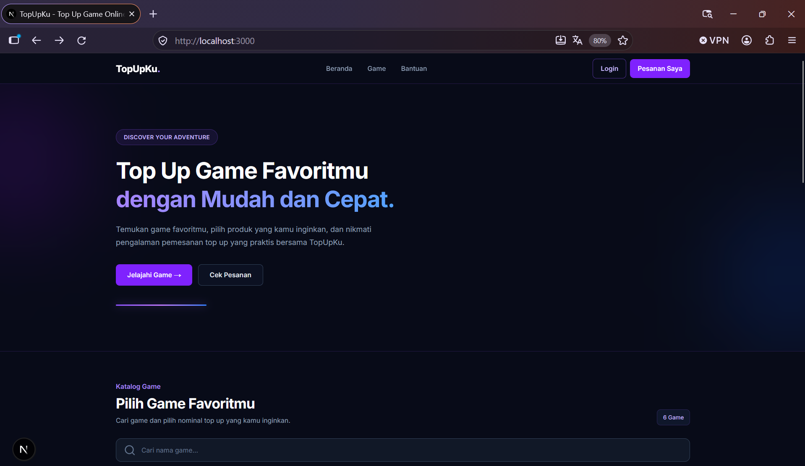
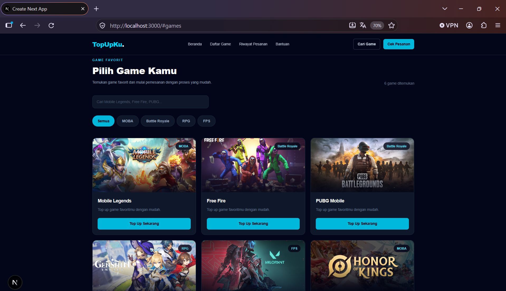
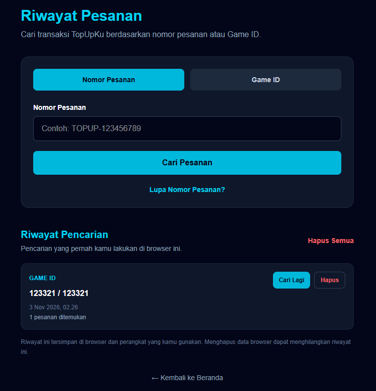
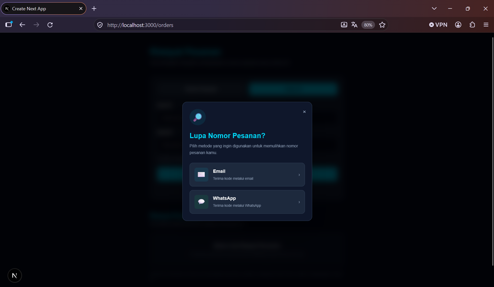
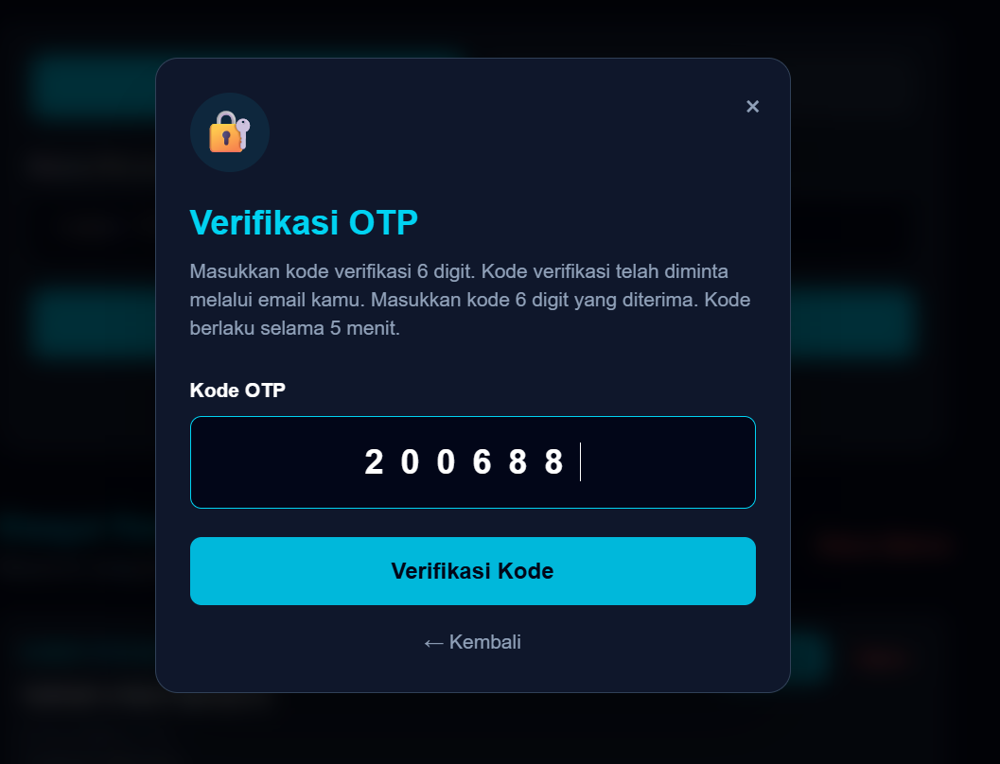

# TopUpKu — Game Top-Up Website


> **Development Notice**
>
> TopUpKu is temporarily on hiatus while the developer focuses on other personal and professional priorities. Development will resume when circumstances allow.

A game top-up website prototype built with **Next.js, TypeScript, and Supabase**.

TopUpKu provides a simple and user-friendly platform for browsing game products, placing top-up orders, and tracking order history.

> **Project Status:** Functional prototype — Order management, Supabase database integration, and email-based order recovery are implemented using Resend. Payment gateway and game top-up provider integrations are planned for future development.

---


<!-- Continue with your existing README sections here -->

## Screenshots

### Homepage


### Game Selection


### Checkout Page


### Order History


### Search History



Users can review previous searches, repeat a search, and manage their local search history.

### Forgot Order Number


An order number recovery feature that allows users to recover previous order numbers using email verification.

WhatsApp recovery is displayed as a future feature and is currently unavailable.

### Email Recovery


Users can request an order recovery verification code using their registered email address.

The backend checks whether the email is associated with existing order records before processing the recovery request.

### OTP Verification



An email-based OTP verification process integrated with Resend.

- Six-digit verification code.
- OTP expiration after 5 minutes.
- Email-based verification through backend API routes.
- OTP values are hashed before being stored in Supabase.
- Verification attempts are limited to prevent repeated guessing.

### Recovery Result


After successful OTP verification, the system retrieves and displays order numbers associated with the verified email address.

Users can copy their recovered order numbers directly from the result interface.

## Features

**Game Catalog & Checkout**
- Browse available games and their product catalogs.
- Enter game account details (User ID and Zone ID).
- Select game products and proceed through the checkout flow.
- Choose from simulated payment methods.

**Order Management**
- Create and manage top-up orders.
- View order history.
- Look up orders using order numbers or game account details.
- Manage search history.

**Order Recovery**
- Access the forgot order number feature.
- Recover order numbers through email-based OTP verification.
- Verify OTP codes with expiration handling.
- Display and copy recovered order numbers.

## Planned Product Expansion

TopUpKu is designed to support various digital products, including:

- **Game Currency:** Diamonds, UC, Genesis Crystals, Valorant Points, and other in-game currencies.
- **Game Membership:** Weekly Pass, Monthly Card, and other game subscriptions.
- **Game Vouchers:** Digital game vouchers and prepaid codes.
- **Digital Gift Cards:** Steam Wallet, Google Play, PlayStation Store, and other digital gift cards.
- **Gaming Subscriptions:** PlayStation Plus, Xbox Game Pass, and other gaming subscriptions.

## Tech Stack

| Technology | Purpose |
|---|---|
| Next.js 16 | React framework and API routes |
| React | User interface |
| TypeScript | Type-safe development |
| Tailwind CSS | Styling |
| Supabase | Backend and database integration |
| PostgreSQL | Relational data storage |
| Resend | Transactional email delivery |
| Midtrans | Planned payment gateway |
| Git & GitHub | Version control |

## Supported Games

- Mobile Legends
- Free Fire
- PUBG Mobile
- Genshin Impact
- Valorant
- Honor of Kings

## Payment Methods (Prototype)

The checkout interface currently provides simulated payment method selection:

- QRIS
- E-Wallet
- Virtual Account
- Bank Transfer

**Note:** These payment methods are UI simulations only. No real transactions or payment processing are performed.

## Planned Integrations

### Payment Gateway — Midtrans

Midtrans is planned as the payment gateway for processing customer payments.

Planned features:

- Midtrans Sandbox integration.
- QRIS payment integration.
- Virtual Account integration.
- Supported e-wallet payment methods.
- Payment webhook handling.
- Payment status verification.
- Production integration.

### Game Top-Up Provider

TopUpKu is planned to integrate with external game top-up suppliers through API services.

Planned features:

- Supplier API integration.
- Product and price synchronization.
- Automated order fulfillment.
- Transaction status updates.
- Mock Supplier API for development and testing.

**Note:** Payment gateway and supplier integrations are not yet implemented.

## Getting Started

### Prerequisites

Make sure you have installed:

- Node.js
- npm
- Git

You also need:

- A Supabase project.
- A Resend account for email-based OTP delivery.

### 1. Clone the Repository

```bash
git clone https://github.com/imammularif/topupku.git
```

### 2. Navigate to the Project Directory

```bash
cd topupku
```

### 3. Install Dependencies

```bash
npm install
```

### 4. Configure Environment Variables

Create a `.env.local` file in the project root:

```env
SUPABASE_URL=your_supabase_project_url
SUPABASE_SECRET_KEY=your_supabase_secret_key

RESEND_API_KEY=your_resend_api_key
RESEND_FROM_EMAIL=TopUpKu <your-verified-sender-email>

ORDER_OTP_SECRET=your_random_32_byte_secret
```

Replace the placeholder values with your own credentials.

**Important:**

- `SUPABASE_SECRET_KEY` must only be used in server-side code.
- `RESEND_API_KEY` must never be exposed in client-side code.
- `ORDER_OTP_SECRET` should be a strong, randomly generated secret.
- A verified sending domain is required to send emails to arbitrary customer addresses.
- Never commit `.env.local` or expose secret keys in your repository.

Midtrans credentials will be added when payment gateway integration begins.

### 5. Configure the Database

TopUpKu uses Supabase PostgreSQL.

Create the required database tables:

- `orders` — Stores customer order information.
- `order_recovery_otps` — Stores hashed OTP verification records and expiration information.

Enable Row Level Security (RLS) and configure appropriate permissions for database access.

The recovery API uses server-side Supabase credentials to access the required records.

### 6. Run the Development Server

```bash
npm run dev
```

Open http://localhost:3000 in your browser.

### 7. Production Build

```bash
npm run build
```

## Database

TopUpKu uses Supabase with PostgreSQL to store order and recovery information.

### Orders Table

The `orders` table includes:

- Order ID.
- Order code.
- Customer name.
- Customer email.
- Customer phone.
- Game.
- User ID.
- Zone ID.
- Product.
- Price.
- Payment method.
- Order status.
- Creation timestamp.

### Order Recovery OTP Table

The `order_recovery_otps` table includes:

- Recovery record ID.
- Customer email.
- Hashed OTP.
- Expiration timestamp.
- Verification attempt counter.
- OTP consumption timestamp.
- Creation timestamp.

OTP records are used to support the email-based order recovery process.

## Project Structure

```text
topupku/
├── app/
│   ├── api/
│   │   └── orders/
│   │       ├── recovery/
│   │       │   ├── request/
│   │       │   │   └── route.ts
│   │       │   └── verify/
│   │       │       └── route.ts
│   │       └── route.ts
│   ├── checkout/
│   │   └── page.tsx
│   ├── orders/
│   │   └── page.tsx
│   ├── globals.css
│   ├── layout.tsx
│   └── page.tsx
├── components/
│   ├── GameCard.tsx
│   ├── GameSection.tsx
│   ├── HeroSection.tsx
│   ├── Navbar.tsx
│   └── OrderModal.tsx
├── data/
│   └── games.ts
├── lib/
│   └── supabaseAdmin.ts
├── public/
│   └── games/
├── docs/
│   └── screenshots/
├── package.json
├── package-lock.json
└── README.md
```

### Directory Overview

- **app/** – Next.js App Router pages, layouts, and API endpoints.
- **components/** – Reusable UI components.
- **data/** – Centralized game catalog and product data.
- **lib/** – Shared utilities and backend integration configurations.
- **public/** – Static assets, including game images.
- **docs/** – Project documentation and application screenshots.

## Current Limitations

TopUpKu is currently a functional prototype for learning and portfolio purposes.

- Payment methods are simulated and do not process actual payments.
- Midtrans payment gateway integration is not yet implemented.
- No real QRIS, e-wallet, or Virtual Account transactions are performed.
- Game top-up fulfillment is not connected to an external supplier.
- Order status is not automatically updated through payment webhooks or supplier APIs.
- Email-based OTP recovery requires a verified Resend domain for customer-facing delivery.
- WhatsApp recovery is not yet available.
- Search history is stored locally in the browser and is not synchronized across devices.
- Public order lookup endpoints are intended for prototype testing only.

Additional authentication, authorization, API rate limiting, and privacy protections are required before production deployment.

## Roadmap

### Completed

**Core Application**
- [x] Homepage and game catalog.
- [x] Game selection interface.
- [x] Checkout page.
- [x] Order creation API.
- [x] Order history page.
- [x] Order lookup by order number or game account details.
- [x] Search history management.

**Backend & Integration**
- [x] Supabase database integration.
- [x] Email-based OTP recovery request API.
- [x] OTP verification API.
- [x] Secure OTP hashing and expiration handling.
- [x] Five-minute OTP expiration enforcement on the backend.
- [x] Resend email service integration.
- [x] Custom HTML email template for OTP recovery.
- [x] TOPUPKU email branding, subject, content, and visual design.
- [x] Email OTP delivery testing.
- [x] Recovered order number display and copy functionality.
- [x] OTP request cooldown handling.
- [x] Real-time five-minute OTP countdown timer on the verification form.
- [x] Dynamic remaining OTP validity display.
- [x] OTP countdown warning when less than one minute remains.
- [x] OTP expiration message when countdown reaches zero.

**Code Structure & Development**
- [x] Modular homepage architecture.
- [x] Reusable UI components:
  - [x] Navbar.
  - [x] HeroSection.
  - [x] GameSection.
  - [x] GameCard.
  - [x] OrderModal.
- [x] Centralized game and product data management.
- [x] GitHub repository and version control.
- [x] Next.js 16.4.6 upgrade.
- [x] TypeScript type checking.
- [x] Production build verification.
- [x] GitHub synchronization and update deployment to the main branch.
- [x] OTP countdown implementation committed and pushed to GitHub.

### Future Development Plans

**Email & OTP Enhancement**
- [ ] Add a clear OTP resend interface after the cooldown period.
- [ ] Improve email delivery monitoring and error handling.
- [ ] Verify a custom sending domain for Resend.
- [ ] Perform additional OTP expiration and resend testing.

**User Experience Improvements**
- [ ] Add copy order number notification.
- [ ] Improve checkout form validation.
- [ ] Add loading states for API requests.
- [ ] Prevent duplicate submissions during order processing.
- [ ] Improve responsive design for mobile devices.

**Code Quality & Security**
- [ ] Further code refactoring and service-layer separation.
- [ ] Implement reusable order history and recovery hooks.
- [ ] Improve order code generation.
- [ ] Strengthen API security and data protection.
- [ ] Implement IP-based rate limiting and abuse prevention.
- [ ] Implement customer authentication.
- [ ] Improve order lookup security and verification.

**Payment Integration**
- [ ] Register Midtrans merchant account.
- [ ] Integrate Midtrans Sandbox.
- [ ] Implement QRIS and Virtual Account payments.
- [ ] Integrate supported e-wallet methods.
- [ ] Implement payment webhooks.
- [ ] Implement payment status verification.
- [ ] Prepare production integration.

**Supplier Integration**
- [ ] Research suitable game top-up providers.
- [ ] Implement Mock Supplier API.
- [ ] Integrate supplier API.
- [ ] Implement automated order fulfillment.
- [ ] Implement transaction status synchronization.

**Product Catalog Expansion**
- [ ] Expand the catalog beyond game diamonds and currencies.
- [ ] Add game memberships and subscriptions.
- [ ] Add digital game vouchers and gift cards.
- [ ] Support more games and digital products.

**Integration & Deployment**
- [ ] Complete end-to-end email recovery testing.
- [ ] Prepare production deployment.
- [ ] Complete security and transaction testing.

## Customer Support

TopUpKu provides an email contact channel for users who need assistance or have questions regarding their orders and transactions.

Email: your-support-email@example.com

When contacting support, users are encouraged to include:

- Order number (if available).
- Game name and product.
- Description of the issue or inquiry.
- Relevant transaction details.

**Note:** Never share passwords, OTP verification codes, or sensitive payment information through email.

## Disclaimer

TopUpKu is an independent learning and portfolio project.

Payment processing and game top-up fulfillment are not currently available for real transactions.

This project is not affiliated with or officially endorsed by the game publishers mentioned above.

## Author

**Imammul Arif**

GitHub: [@imammularif](https://github.com/imammularif)

Project Repository: [TopUpKu](https://github.com/imammularif/topupku)

Portfolio: [imammularif.github.io/portfolio-V2.0](https://imammularif.github.io/portfolio-V2.0)
